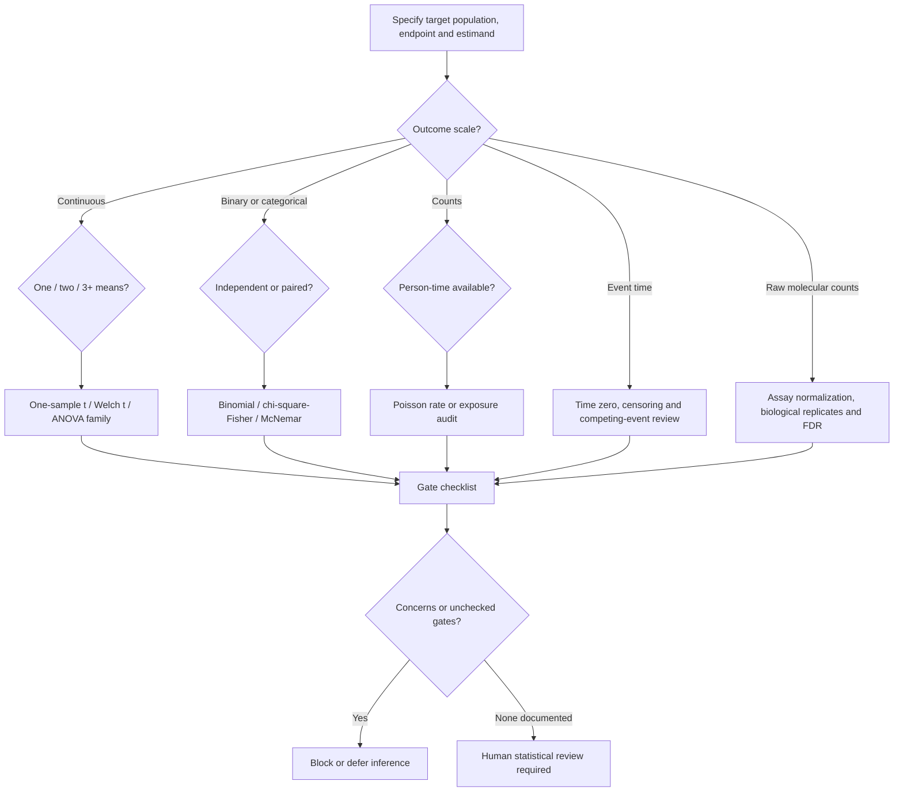

# Biomedical statistical decision matrix — Version 2

[Statistics foundations](BREAST_CANCER_STATISTICS_FOUNDATIONS.md) · [Rosner-aligned matrix](ROSNER_TEST_SELECTION_MATRIX.md) · [Breast cancer worked tests](BREAST_CANCER_WORKED_TEST_ATLAS.md) · [27-route registry](biomedical_decision_matrix.csv) · [25-gate dictionary](biomedical_gate_dictionary.csv) · [R adviser](../../06_RESOURCES/R/biomedical_matrix_gate_review.R)

**Paul's Notes | 2026-11-14 | Synthetic teaching layer.** This matrix extends the existing `biomedical_method_decision()` routes with structured clinical context and explicit pre-inference checks. It does **not** replace the original selector, download study records, execute a statistical test or certify a model's eligibility. Breast cancer is the continuous narrative, not a restriction on which cancers the methods apply to.

## The workflow from question to defensible analysis



**Design overrides outcome-only testing:** before accepting any simple two-sample test, check whether patients are paired, observed repeatedly, clustered at sites, sampled with weights, or used as multiple tumor specimens. Repeated cells are not independent patients. Endpoint definition, unit of analysis, missingness and denominator take precedence over formula selection.

## Decision routing at a glance

| Clinical endpoint / study design | Preferred selector route | Breast cancer research question | Main interpretation |
| --- | --- | --- | --- |
| One quantitative summary | `descriptive` | Distribution of tumor-marker scores | Mean/SD or median/IQR, not a p-value |
| One categorical summary | `descriptive-categorical` | ER-positive share of evaluable tumors | Numerator, denominator and missingness |
| Repeated descriptive records | `descriptive-design-review` | Serial biopsies per woman | Report patients and specimens separately |
| Complex survey | `survey-design-review` | Weighted screening prevalence | Population-weighted estimate and design SE |
| Repeated/clustered outcome | `correlated-outcome-review` | Biomarker trajectory | Marginal vs cluster-specific effect |
| Raw gene counts | `omics-design-review` | ESR1-related expression contrast | Log2 fold change, FDR, biological n |
| Prediction | `prediction-validation-review` | Predict recurrence from baseline markers | Held-out calibration and discrimination |
| Adjusted regression | `adjusted-model-review` | Stage-adjusted response association | Outcome-specific adjusted effect and CI |
| Time plus event/censoring | `survival-analysis-review` | Time to first recurrence | Survival probability or hazard ratio |
| Unspecified time zero | `time-origin-review` | Define entry after surgery | Confirm event and risk-set contract |
| Counts plus person-time | `count-rate-model-review` | Unplanned care visits/year | Event rate ratio, not risk ratio |
| Counts with missing exposure | `count-exposure-review` | Visits with unequal follow-up | Audit observation denominator first |
| Predictor/outcome association | `association-model-review` | Age and biomarker | Correlation, slope or adjusted association |
| Two linked continuous values | `paired-t` | Pre/post marker in same patients | Mean after-minus-before difference |
| Matched binary statuses | `mcnemar` | ER status changed pre/post | Discordant pairs |
| Paired ordinal measures | `signed-rank` | Pre/post toxicity grade | Rank shift with tie/symmetry caveats |
| Complex matched outcome | `paired-design-review` | Three timepoints per patient | Require repeated model, not paired t |
| Unknown number of groups | `group-count-review` | Treatment groups unspecified | Clarify group and contrast |
| Two independent continuous arms | `welch-t` | Biomarker A versus B | Mean difference and Welch CI |
| Three-plus independent means | `welch-anova` | Biomarker across three regimens | Omnibus comparison, then adjusted contrasts |
| Undefined continuous comparison | `continuous-design-review` | One sample vs two-arm question unclear | Declare reference and estimand |
| One ordered-category distribution | `ordinal-one-sample-review` | Toxicity grade reference pattern | Category probabilities and goodness of fit |
| Two independent rank outcomes | `wilcox-independent` | Toxicity distribution A vs B | Rank/distribution, not automatically medians |
| Three-plus rank outcomes | `kruskal-wallis` | Toxicity across three arms | Rank omnibus and multiplicity |
| One nominal reference distribution | `nominal-one-sample-review` | Subtype distribution vs benchmark | Expected cells and global fit |
| One binary proportion | `binomial-proportion` | 36 of 80 patients respond | Exact binomial proportion and tail |
| Independent categorical table | `contingency-analysis` | HER2 status and response | Counts, denominators, risk/odds measure |

The machine-readable CSV includes each row's **required fields, gate keys, estimand, breast cancer example, interpretation, common failure and reporting quantity**. The separate Rosner crosswalk supplies textbook chapter navigation. **The central limit theorem, statistical power and confidence intervals are foundations—not hypothesis tests and therefore not selector terminal routes.** Study them in the [foundations chapter](BREAST_CANCER_STATISTICS_FOUNDATIONS.md) and [distribution/power chapter](BREAST_CANCER_DISTRIBUTIONS_AND_POWER.md).

## R: inspect a method, then interrogate its assumption gates

No new packages are required. Run from the **repository root**, and explicitly supply the root to avoid hidden path discovery.

```r
source("06_RESOURCES/R/biomedical_test_selector.R")
source("06_RESOURCES/R/rosner_method_crosswalk.R")
source("06_RESOURCES/R/biomedical_matrix_gate_review.R")

selected <- biomedical_method_decision(
  outcome_type = "continuous",
  design = "independent",
  question = "compare",
  n_groups = 2L,
  include_rosner = TRUE
)
selected$method_id  # "welch-t" (selection unchanged by matrix)

card <- bio_matrix_card(selected, root = ".")
card$estimand_or_target
card$breast_cancer_example
card$interpretation
card$common_pitfall
card$rosner$chapters  # "8"

review <- bio_matrix_gate_review(selected, root = ".")
print(review)
# Default is incomplete. This does not run t.test() or inspect real data.
```

The first run returns `incomplete`, because **all gates start as `not_checked`**. A researcher may record a justified status for individual gates. These are assertions to document and audit, **not** automatically verified statistical assumptions.

```r
partial <- bio_matrix_gate_review(
  selected, root = ".",
  judgments = c(
    unit = "documented",
    scale = "documented",
    independence = "concern"
  )
)
partial$review_state  # "blocked_by_concern"
partial$gate_assessments
```

If every required gate is marked `documented`, the review state changes only to **`ready_for_human_review`**, never `validated`. A specialist still needs to confirm clinical design, diagnostics, estimand, governance, data integrity and test applicability.

## Gate status contract

| Status | Meaning | Permitted next action |
| --- | --- | --- |
| `not_checked` (default) | No evidence supplied | Investigate; cannot proceed as validated |
| `documented` | Researcher has recorded evidence | Have an independent reviewer confirm |
| `concern` | Assumption, data or design problem identified | Block or revise the analysis |
| `incomplete` | At least one required gate unchecked, none flagged | Obtain missing documentation |
| `blocked_by_concern` | At least one gate flagged | Escalate problem before inference |
| `ready_for_human_review` | All required gates marked documented | Human approval still necessary |

No score or threshold converts these status flags into proof of an assumption.

## Six breast-cancer decision examples

**A — Two independent biomarker groups.** One measurement per patient, two arms, continuous endpoint. Select `welch-t` for an *unadjusted mean difference*, then confirm person-level independence, group labels, outliers, scale, missingness and contrast direction. Report mean A minus B with Welch confidence interval. The earlier [numerical validation chapter](BREAST_CANCER_NUMERICAL_VALIDATION.md) gives a synthetic example: A−B = −3.50 (95% CI approximately −7.50 to 0.50); this does not demonstrate equivalence.

**B — Two biopsies from each patient.** The same patient contributes a pre/post measure. Select `paired-t` if continuous change and two matched visits are appropriate; the *difference vector* is the analytic outcome. Pair IDs and visit timing are mandatory. Two samples from one person cannot be treated as independent arms.

**C — Three independent regimens.** A continuous outcome across three groups is `welch-anova` in the existing default selector. The omnibus test asks whether all means are equal; it does not identify which pair differs. Record assumptions and planned adjusted contrasts. A researcher who specifically needs conventional common-variance ANOVA must justify that model separately; the matrix does not silently substitute it.

**D — Repeated events during follow-up.** A patient with three emergency visits over 0.5 person-years differs in exposure from one with three visits over two years. Select `count-rate-model-review` only after positive person-time is known; the Poisson log-offset produces rate ratios. Assess overdispersion, zeros and dependence before inference.

**E — One sample of responders.** If 36/80 hypothetical patients respond and the predefined reference is 0.35, the `binomial-proportion` route concerns an exact upper-tail count probability under the null. It is *not* evidence that a treatment caused the responses.

**F — Time to recurrence.** Event time without a defined time origin, event coding, censoring rules and competing events triggers a review, not automatic Cox regression. Once specified, choose Kaplan–Meier/log-rank/Cox or competing-risk analysis for the actual estimand.

## Validation and reproducibility

```bash
python3 scripts/check_biostatistics_matrix.py
python3 -m unittest discover -s scripts/tests -p 'test_biostatistics_matrix.py' -v
Rscript --vanilla 06_RESOURCES/tests/test_biomedical_matrix_gate_review.R
Rscript --vanilla 06_RESOURCES/tests/test_biomedical_test_selector.R
Rscript --vanilla 06_RESOURCES/tests/test_rosner_method_crosswalk.R
```

The Python validator checks the 27 unique route IDs against the Rosner crosswalk and selector, verifies all 25 gate definitions and rejects duplicates, unknown gates, blank cells and invalid route classes. The R suite exercises **every route**, assumption-state transitions, and failure cases without reading patient data.

**Evidence levels:** GitHub commit is a repository update; executable Python tests are structural validation only; R regression tests require a real R runtime; neither certifies clinical adequacy. Keep G0/G1 source/permission, G2 schema, G3 study design, G5 inference, G7 figures and G8 independent replay as separate gates.

## Source and crosswalk boundaries

- **Foundational text:** Bernard Rosner, *Fundamentals of Biostatistics*, 8th ed., Cengage (2016). See [chapter registry](rosner_method_registry.csv) and [original decision matrix](ROSNER_TEST_SELECTION_MATRIX.md); topical chapter links are not copied textbook algorithms.
- **Method evidence:** [decision-tree publication atlas](README.md) and [recent biomedical R literature](../../06_RESOURCES/Literature/BIOSTATISTICS_R_LITERATURE_2021_2026.md).
- **Cancer application:** [26-method worked interpretation atlas](BREAST_CANCER_WORKED_TEST_ATLAS.md), [study-design chapter](CANCER_STUDY_DESIGN.md) and [fully worked synthetic calculations](BREAST_CANCER_NUMERICAL_VALIDATION.md).
