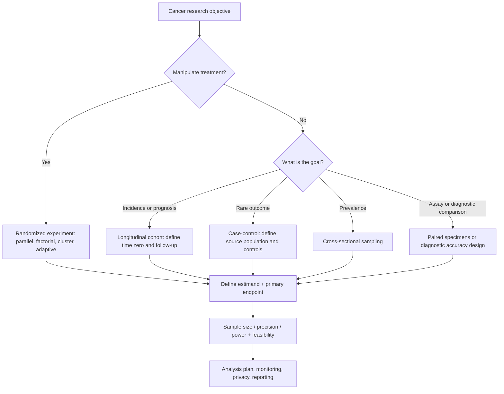

# Designing a Cancer Study: From Research Question to Defensible Sample Size

[Statistics foundations](BREAST_CANCER_STATISTICS_FOUNDATIONS.md) · [Distribution and power guide](BREAST_CANCER_DISTRIBUTIONS_AND_POWER.md) · [Worked breast cancer tests](BREAST_CANCER_WORKED_TEST_ATLAS.md) · [Design calculator](../examples/breast_cancer_study_design.R) · [Synthetic validation](../tests/test_breast_cancer_study_design.R) · [Study protocol template](../../templates/study-protocol.md)

**Independent teaching chapter · November 2026.** Breast cancer is the running narrative; methods transfer to other cancer sites. All numerical assumptions and scenarios below are hypothetical, **not observed trial results or treatment recommendations**. Core probability, hypothesis testing and power foundations follow the [eighth-edition methodological references](../../02_biomedical_coding/METHODOLOGY_SOURCE_REFERENCES.md). Modern protocol/reporting standards and oncology endpoint guidance are cited at the end. This is a learning resource, not a complete protocol ready for human-participant recruitment.

## Worked end-to-end companion

The [frozen synthetic breast cancer protocol-to-results exercise](BREAST_CANCER_PROTOCOL_TO_RESULTS.md) translates this design framework into [cohort generation and prespecified analysis](../examples/breast_cancer_protocol_replay.R), a [knit-ready Methods/Results report](../examples/breast_cancer_protocol_report.Rmd), and [replay tests](../tests/test_breast_cancer_protocol_replay.R). Outcomes are deliberately synthetic and cannot support clinical claims.

## 1. Begin with the research question, not the test

**Motivating question:** Among adults with a defined breast cancer subtype beginning specified treatment, does an intervention change the risk of pathological response compared with standard care?

A research question must name (a) target population, (b) exposure/treatment, (c) comparator, (d) outcome, (e) time horizon, (f) scientific purpose and (g) the *unit* enrolled and analyzed. "Find a statistically significant difference" is **not** a meaningful study objective.

| Purpose | Hypothetical breast cancer question | Suitable starting design | Principal limitation |
| --- | --- | --- | --- |
| Descriptive | What fraction of a registry's eligible tumors are HER2-positive? | Defined registry cross-section | Selection and assay completeness |
| Etiologic association | Is exposure associated with later breast cancer incidence? | Cohort or case-control | Confounding and time-related bias |
| Intervention effect | Does randomized A versus B change pathological response? | Parallel-group randomized trial | Recruitment, adherence, intercurrent events |
| Prognostic | Does baseline stage predict recurrence by five years? | Inception cohort with follow-up | Calibration, transportability |
| Diagnostic accuracy | How accurately does a test detect a defined pathology reference? | Paired diagnostic accuracy study | Spectrum bias and reference standard |
| Translational | Which genes change in paired tumor specimens? | Paired molecular/assay experiment | Biological replication, batch, multiplicity |
| Feasibility | Can patients complete serial blood draws? | Pilot/feasibility study | Not powered for efficacy claims |

Randomization addresses baseline confounding *in expectation* for eligible trial participants; it does not automatically solve loss to follow-up, measurement error, postrandomization selection, or transportability.

## 2. Study diagram and design family

In cohort work, establish eligibility, treatment/exposure assignment and follow-up time zero coherently; avoid immortal time bias. In a case-control study, odds ratios are natural, but disease incidence usually cannot be read from case-control sampling fractions. In cross-sectional prevalence work, justify the sampling design and weights before population claims. Repeated tumor cells are not independent patients.

## 3. Define the estimand before choosing a model

The *estimand* specifies the scientific treatment effect or contrast of interest: population, treatment conditions, endpoint, strategy for postbaseline intercurrent events, and summary measure. In a hypothetical randomized neoadjuvant trial, consider:

- **Population:** all randomized eligible participants with a specified disease definition.
- **Treatment:** assigned intervention versus standard care.
- **Variable:** pathological complete response determined at prespecified surgery, with documented assessment rules.
- **Intercurrent events:** treatment discontinuation, switching, surgery not performed, progression or death before assessment. Define each handling strategy explicitly; do not silently exclude participants.
- **Summary:** difference in pCR probability (intervention minus control) at the prespecified endpoint.

Treatment-policy, composite, hypothetical, while-on-treatment and principal-stratum strategies answer different questions; no single strategy is universally correct. A treatment-policy approach is not synonymous with a naive complete-case analysis. Specify data collection and statistical method to actually target the estimand. [ICH E9(R1)](https://www.fda.gov/media/148473/download) and the [estimands primer](https://www.bmj.com/content/384/bmj-2023-076316) explain these distinctions.

## 4. Choose and operationalize the endpoint

| Outcome | Exact variable needed | Typical analysis | Key oncology-specific risk |
| --- | --- | --- | --- |
| Pathological complete response | Prespecified pathology definition, denominator, surgery window | Binary proportion difference / logistic regression | Missing surgery/assessment and definition drift |
| Tumor size change | Baseline size, post-treatment size, units/time | Paired change / ANCOVA / mixed model | Measurement reproducibility |
| Adverse-event grade | Ordered grade and event window | Ordinal model / table | Unequal follow-up, grading versions |
| Disease-free survival | Time zero, qualifying events, event/censor timestamps | Kaplan–Meier / Cox; endpoint-specific rules | Definitions and assessment schedule |
| Progression-free survival | Progression/death criteria, scans, censor rules | Time-to-event methods | Informative scans, interval assessment |
| Overall survival | Death date or final known alive date | Survival methods | Long follow-up, competing noncancer deaths for cause-specific aims |
| Cumulative recurrence incidence | First recurrence, death without recurrence, censoring | Competing-risk cumulative incidence | Death cannot simply be censored for risk estimand |
| Gene-expression contrast | Raw counts, person/specimen IDs, batches, replicate structure | Assay-aware differential expression / FDR | Pseudoreplication and leakage |

The FDA's [Clinical Trial Endpoints for Approval of Cancer Drugs and Biologics](https://www.fda.gov/regulatory-information/search-fda-guidance-documents/clinical-trial-endpoints-approval-cancer-drugs-and-biologics) is a relevant regulatory resource, not a blanket endorsement of any endpoint in this hypothetical study. The FDA's [August 2025 overall survival assessment guidance](https://www.fda.gov/regulatory-information/search-fda-guidance-documents/approaches-assessment-overall-survival-oncology-clinical-trials) is explicitly a **draft**, not final implementation guidance.

For a breast cancer study, document the exact pathological complete response definition, whether residual in situ disease is allowed, the nodal component, and the surgery assessment window. For recurrence endpoints, list the component events and competing-death rule. The [clinical-data chapter](../../oncology/chapters/CO-02-clinical-oncology-data.md#5-endpoint-semantics-and-the-denominator) supplies the breast-specific endpoint and source-selection distinctions; an acronym alone is not an analysis specification.

## 5. Select the primary statistical family and reporting target

| Primary endpoint | Estimand / target | Analysis planning options | Never confuse |
| --- | --- | --- | --- |
| Continuous baseline-adjusted marker | Adjusted mean difference | ANCOVA / linear model; Welch only for unadjusted independent means | SD of individuals vs SE of estimator |
| Binary pCR | Risk difference, relative risk, or odds ratio (define one) | Two-proportion design, logistic or binomial model | Odds ratio vs risk ratio |
| Repeated biomarker measurements | Mean trajectory difference | Linear mixed model or GEE | Repeated rows vs independent patients |
| Count of encounters | Incidence rate ratio | Poisson GLM + log(person-time) offset; assess NB | Counts vs rates |
| Time to first recurrence/death | Hazard or survival contrast | Log-rank / Cox / RMST where appropriate | Hazard ratio vs probability of event |
| Multiple transcripts | Prespecified gene-wise differences | limma/edgeR/DESeq2 + multiplicity | Technical versus biological replicates |

**Choose the estimand first**; the test is an estimation procedure tailored to it. Noninferiority/equivalence studies require justified margins and separate design rules—not merely a nonsignificant superiority test.

## 6. Sample-size principles: all assumptions must be visible

A well-documented plan specifies the primary effect size deemed clinically meaningful, underlying event rate or SD, alpha and sidedness, power, allocation, expected missingness, correlation/clustering, timing and feasibility. Use external defensible evidence for assumed control rate/variance, and distinguish an *assumption* from measured truth. Sample-size software, formula version and parameter source belong in the protocol. [SPIRIT 2025](https://www.bmj.com/content/389/bmj-2024-081477) and its [explanation](https://pmc.ncbi.nlm.nih.gov/articles/PMC12128891/) describe these expectations.

### 6.1 Continuous endpoint, two independent groups

Let $\Delta=\mu_T-\mu_C$ be the target treatment-minus-control mean difference, $\sigma$ a common **planning standard deviation**, $\alpha$ the two-sided Type I error probability, and $1-\beta$ the target power. Write $z_q=\Phi^{-1}(q)$ for the $q$th standard-normal quantile. With equal allocation and independent observations, $\operatorname{Var}(\bar X_T-\bar X_C)=2\sigma^2/n$; a normal approximation therefore gives the unrounded requirement per group:

$$
n_{\mathrm{per\ group}}
\approx
\frac{2\left(z_{1-\alpha/2}+z_{1-\beta}\right)^2\sigma^2}{\Delta^2}.
$$

For a hypothetical **5-unit clinically meaningful score difference**, planning $\sigma=12$, two-sided $\alpha=.05$ and power $.80$, the normal approximation gives $n\approx90.419$ per arm; rounding up gives **91 analyzable participants per arm**. The effect and standard deviation must be expressed in the same measurement units. The numbers are original planning assumptions, not observed treatment effects.

The [R documentation for `stats::power.t.test()`](https://www.stat.ethz.ch/R-manual/R-devel/library/stats/html/power.t.test.html) describes a separate t-distribution calculation. Use `stats::power.t.test(delta=5, sd=12, sig.level=.05, power=.80, type="two.sample", alternative="two.sided")` and round its returned per-arm requirement up. Record the routine's `strict` argument; the default `FALSE` counts rejection in the direction of the assumed effect, whereas `TRUE` includes both rejection tails. The equal planning variance does not require a pooled-variance analysis; planned Welch inference needs its own unequal-variance scenarios.

For allocation ratio $r=n_T/n_C$ and the same planning standard deviation, the variance becomes $\sigma^2(1+1/r)/n_C$. The approximate unrounded requirements are:

$$
n_C
\approx
\frac{\left(z_{1-\alpha/2}+z_{1-\beta}\right)^2\sigma^2}{\Delta^2}
\left(1+\frac{1}{r}\right),
\qquad n_T\approx r\,n_C.
$$

Round recruitment targets to feasible integers and report the achieved allocation. Under these equal-variance assumptions, moving away from $r=1$ increases the total requirement for a fixed target contrast. Enrollment feasibility, cost and precision can justify another allocation.

**Numerical reference:** With the stated assumptions and 10% unavailable primary endpoints, inflating the rounded normal-approximation requirement gives **102 enrolled participants per arm**. This value is distinct from the t-distribution calculation and from the survival-event requirement in §6.5. The existing [design calculator](../examples/breast_cancer_study_design.R) retains both normal and t-based outputs with separate labels.

### 6.2 Binary response endpoint

Let the *hypothetical planning* control pCR probability be 0.30 and intervention probability 0.45, with absolute difference .15. Use [`stats::power.prop.test()`](https://www.stat.ethz.ch/R-manual/R-devel/library/stats/html/power.prop.test.html) with `p1=.30, p2=.45, power=.80, sig.level=.05, alternative="two.sided"` for a standard equal-arm approximate design; record the chosen `strict` argument, as in §6.1. **Round up** each arm. In a protocol, identify the effect scale (risk difference, OR, etc.) and justify the assumed .30 and .45; do not call them historical trial results unless verified. Exact, score, regression-adjusted and simulation-based designs may require different sample sizes.

### 6.3 Attrition and missing primary outcomes

Let $\ell$ be the expected fraction without an analyzable primary outcome, with $0\leq\ell<1$. A simple enrollment inflation is:

$$
n_{\mathrm{enroll}}
=
\left\lceil
\frac{n_{\mathrm{analyzable}}}{1-\ell}
\right\rceil.
$$

For $n_{\mathrm{analyzable}}=91$ and $\ell=.10$, $\lceil91/.90\rceil=102$. This arithmetic increases recruitment; it does not repair outcome-dependent missingness, define how discontinuation or death enters the endpoint, or guarantee that the selected estimator targets the intended effect. Prespecify intercurrent-event strategies and missing-data assumptions separately in the [protocol template](../../templates/study-protocol.md), following [ICH E9(R1), final FDA guidance, §A.3 and §A.5](https://www.fda.gov/media/148473/download).

### 6.4 Repeated measurements and clustering

For m=4 approximately equal observations per cluster and intraclass correlation ICC=.15, the simple equal-cluster design effect is `DE=1+(m-1)*ICC=1.45`. Effective information is reduced; roughly multiply an independent-observation requirement by DE **only as an illustrative cluster sampling approximation**. When measurements repeat within an individual, model the actual within-person covariance, time effects and dropout rather than treating DE as a universal longitudinal sample-size multiplier.

### 6.5 Survival event-driven sample size

For a two-group proportional-hazards planning approximation, let $q$ be the fraction allocated to treatment, $\mathrm{HR}$ the target treatment-to-control hazard ratio, and $D$ the required number of observed primary events. Using the same $\alpha$, $\beta$ and standard-normal quantiles as §6.1:

$$
D
\approx
\frac{\left(z_{1-\alpha/2}+z_{1-\beta}\right)^2}
{q(1-q)\left\{\log(\mathrm{HR})\right\}^2}.
$$

For hypothetical $\mathrm{HR}=.75$, $q=.5$, two-sided $\alpha=.05$ and power $.80$, the expression gives $D\approx379.352$, rounded up to **380 observed events**. The logarithm is natural. The formula is an asymptotic planning approximation for the specified survival contrast; its foundation is the [original proportional-hazards sample-size paper](https://pubmed.ncbi.nlm.nih.gov/6354290/).

The event requirement must be translated into recruitment using an accrual schedule, entry times, follow-up, baseline event distribution, dropout and endpoint-specific competing events. **Events and recruited participants are different quantities.** A guessed event fraction does not establish an adequate clinical design.

Proportional hazards alone does not remove every approximation. A [2026 methodological analysis](https://doi.org/10.1177/09622802261427024) examines the risk-set proportionality assumption behind this formula and shows why simulation can be valuable when that approximation is weak. Evaluate planned follow-up, unequal risk sets and departures from proportional hazards in design-specific scenarios; do not label this single calculation a simulation-validated trial design.

### 6.6 Multiple primary endpoints and interim analyses

Prespecify the hypothesis family, alpha allocation, co-primary success rule (AND versus OR), and any group-sequential monitoring before data collection. Bonferroni alpha/m is a conservative example for m primary claims; it is not the unique or always optimal procedure. Repeated unplanned looks at outcomes can inflate Type I error. Stopping boundaries, independent monitoring and adaptations require specialist review.

## 7. Three complete worked hypothetical proposals

| Proposal | Primary endpoint | Planning inputs | Design risks | Reporting artifact |
| --- | --- | --- | --- | --- |
| A. Parallel randomized intervention | pCR at surgery | p0=.30, p1=.45; alpha=.05; 80% power; 1:1; 10% unavailable | Intercurrent events, pathological assessment, adherence, missing surgery | CONSORT 2025 flow, trial estimand, risk-difference CI |
| B. Prospective observational cohort | First recurrence by five years | Baseline event assumptions, clinically relevant HR; required events | Confounding, censoring, time-zero bias, competing death | STROBE-style cohort reporting, prognostic discrimination and calibration where relevant |
| C. Paired tumor molecular study | Prespecified log-expression change or gene-level FDR | Patient pairs; variance of **paired difference**, assay batch and FDR plan | Missing pairs, specimen purity, high-dimensional testing | Paired scatter/estimate plot, effect CI, FDR and provenance |

**Worked decision for Proposal A.** For binary pCR, enroll participants, randomize independently within a planned scheme, record eligible N and assigned groups, prespecify whether missing surgery is treated as composite nonresponse or another defensible strategy, and define the analysis denominator. Use `power.prop.test()` for transparent initial planning, then rerun under more conservative control response rates, smaller clinically meaningful differences and greater loss. The answer is an *assumption-driven design scenario*, not a clinical recommendation or proof of power for the implemented study.

**Worked decision for Proposal B.** At diagnosis/defined eligibility, construct an inception cohort and explicitly begin follow-up. Identify all-cause death or recurrence as competing versus composite outcomes as defined; plan follow-up sufficiently to observe the target number of events. A baseline hazard and projected recruitment schedule matter more than merely stating "80% power." A naive Cox model is not a calibrated prognosis tool without validation.

**Worked decision for Proposal C.** Power a paired patient-level contrast using **SD of within-patient differences** rather than the independent cross-sectional SD; see `power.t.test(type="paired")` with a clinically relevant difference. For thousands of transcripts, FDR-aware simulation and biological replicates are necessary; a single-gene t-test sample size is not a genome-wide guarantee.

## 8. Bias, missingness and analysis populations

| Threat | What to document | Mitigation / sensitivity |
| --- | --- | --- |
| Selection/confounding | Eligibility, source population, treatment selection, measured covariates | Randomization or defensible adjustment; causal assumptions |
| Immortal time | Eligibility and zero time, exposure timing | Align entry/assignment with follow-up |
| Measurement error | Assay validation, pathology consistency, blinded reading | Calibration, adjudication, replicate checks |
| Postrandomization exclusions | Every assigned, treated and analyzed participant | Estimand-consistent primary analysis; sensitivity |
| Missingness | Observed/expected n by arm, timing and reasons | MI or model-based sensitivity with justified assumptions; MNAR scenarios |
| Cluster dependence | Patient/site/batch IDs | Random effects or GEE/design-aware SE |
| Multiple looks/tests | Family and planned interim schedule | Prespecified alpha spending, adjusted intervals/FDR |

**Analysis population is not an estimand.** Intention-to-treat terminology does not by itself solve missing responses. An intercurrent event, such as treatment switching, affects the interpretation or existence of an outcome; failure to collect a relevant measurement creates a missing-data problem. A composite strategy can define progression or death before surgery as failure, while an unavailable pathology report still needs its stated handling rule. Complete-case analysis changes the analyzed set; counting every unavailable assessment as nonresponse changes the response definition unless that endpoint was explicitly chosen. These decisions belong in the protocol, following [ICH E9(R1), §A.3–A.5](https://www.fda.gov/media/148473/download).

## 9. Reproducibility, ethics and governance

Before prospective human research, complete scientific/ethical review, enrollment consent pathway, trial registration where applicable, data stewardship and privacy controls. This public repository stores only synthetic fixtures, aggregate literature evidence and executable methods, never restricted participant-level records. Lock analysis code, variable dictionary, randomization/stratification plan, protocol version, primary analysis and allowable deviations **before** accessing unblinded endpoint comparisons. Treat adaptive design and interim efficacy monitoring as specialist activities.

**Release gates:** G0 sources; G1 data permission; G2 schema, units/IDs; G3 design/estimand; G5 assumptions/power/sensitivity; G7 figures; G8 clean independent replay. Model prediction adds G4 split/leakage and G9 held-out validation. Failing a gate blocks clinical claims even when code passes tests.

## 10. Researcher study-design worksheet

Copy these fields to the [protocol template](../../templates/study-protocol.md): objective and PICO; design; primary endpoint and assessment window; population/eligibility; independent unit; comparator; estimand and intercurrent-event strategies; primary contrast/alpha/sidedness; analysis method; clinically meaningful effect and evidence for control distribution; variance/event assumptions; target power; sample size and allocation; missingness/attrition; clustering; accrual and survival follow-up; multiplicity/interim looks; safeguards and privacy; bias limitations; source citations; software versions; sensitivity scenarios; prospective registration and protocol freeze.

## References and guideline hierarchy

1. *Fundamentals of Biostatistics*, 8th ed. (2016): see the [canonical methodology bibliography](../../02_biomedical_coding/METHODOLOGY_SOURCE_REFERENCES.md) for full author attribution, edition and source-review scope.
2. [SPIRIT 2025 randomized trial protocol guidance](https://www.bmj.com/content/389/bmj-2024-081477); [explanation of sample-size reporting](https://pmc.ncbi.nlm.nih.gov/articles/PMC12128891/).
3. [CONSORT 2025 randomized trial reporting guidance](https://pmc.ncbi.nlm.nih.gov/articles/PMC11995449/), particularly endpoints, sample size, participant flow and missing data.
4. [ICH E9(R1), estimands and sensitivity analysis, final FDA guidance (May 2021)](https://www.fda.gov/media/148473/download); [2024 BMJ primer](https://www.bmj.com/content/384/bmj-2023-076316).
5. [FDA oncology endpoints guidance page](https://www.fda.gov/regulatory-information/search-fda-guidance-documents/clinical-trial-endpoints-approval-cancer-drugs-and-biologics); [FDA August 2025 overall survival draft guidance](https://www.fda.gov/regulatory-information/search-fda-guidance-documents/approaches-assessment-overall-survival-oncology-clinical-trials) (**draft**, not final).
6. [STROBE observational study reporting](https://www.strobe-statement.org/checklists/); [TRIPOD+AI predictive model reporting](https://www.tripod-statement.org/).

**Verification scope:** On 2026-11-21, the displayed normal-approximation, attrition and event-count arithmetic was independently replayed in Python. This is distinct from executing the [design R module](../examples/breast_cancer_study_design.R) and its [tests](../tests/test_breast_cancer_study_design.R), which require a working R installation. Guideline citations support design/reporting principles, not the hypothetical planning assumptions. The [development checkpoint](../../docs/agent-tasking.md#2026-11-21-investigator-reference-development-checkpoint) records the precise checks and remaining review requirements.
