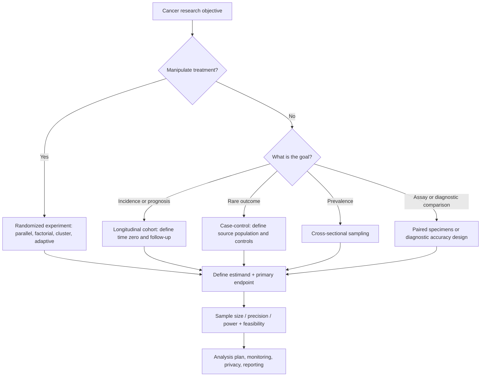

# Designing a Cancer Study: From Research Question to Defensible Sample Size

[Statistics foundations](BREAST_CANCER_STATISTICS_FOUNDATIONS.md) · [Distribution and power guide](BREAST_CANCER_DISTRIBUTIONS_AND_POWER.md) · [Worked breast cancer tests](BREAST_CANCER_WORKED_TEST_ATLAS.md) · [Design calculator](../examples/breast_cancer_study_design.R) · [Synthetic validation](../tests/test_breast_cancer_study_design.R) · [Study protocol template](../../templates/study-protocol.md)

**Independent teaching chapter · November 2026.** Breast cancer is the running narrative; methods transfer to other cancer sites. All numerical assumptions and scenarios below are hypothetical, **not observed trial results or treatment recommendations**. Rosner, *Fundamentals of Biostatistics* (8th ed.), supplies core probability, hypothesis tests and power foundations. Modern protocol/reporting standards and oncology endpoint guidance are cited at the end. This is a learning resource, not a complete protocol ready for human-participant recruitment.

## Worked end-to-end companion\n\nThe [frozen synthetic breast cancer protocol-to-results exercise](BREAST_CANCER_PROTOCOL_TO_RESULTS.md) translates this design framework into [cohort generation and prespecified analysis](../examples/breast_cancer_protocol_replay.R), a [knit-ready Methods/Results report](../examples/breast_cancer_protocol_report.Rmd), and [replay tests](../tests/test_breast_cancer_protocol_replay.R). Outcomes are deliberately synthetic and cannot support clinical claims.\n\n## 1. Begin with the research question, not the test

**Motivating question:** Among adults with a defined breast cancer subtype beginning specified treatment, does an intervention change the risk of pathological response compared with standard care?

A research question must name (a) target population, (b) exposure/treatment, (c) comparator, (d) outcome, (e) time horizon, (f) scientific purpose and (g) the *unit* enrolled and analyzed. "Find a statistically significant difference" is **not** a meaningful study objective.

| Purpose | Hypothetical breast cancer question | Suitable starting design | Principal limitation |
| --- | --- | --- | --- |
| Descriptive | What fraction of a registry's eligible tumors are HER2-positive? | Defined registry cross-section | Selection and assay completeness |
| Etiologic association | Is exposure associated with later breast cancer incidence? | Cohort or case-control | Confounding and time-related bias |
| Intervention effect | Does randomized A versus B change pathological response? | Parallel-group randomized trial | Recruitment, adherence, intercurrent events |
| Prognostic | Does baseline stage predict recurrence by five years? | Inception cohort with follow-up | Calibration, transportability |
| Diagnostic accuracy | How accurately does a test detect a defined pathology reference? | Paired diagnostic accuracy study | Spectrum bias and reference standard |
| Translational | Which genes change in paired tumor specimens? | Paired molecular/assay experiment | Biological replication, batch, multiplicity |
| Feasibility | Can patients complete serial blood draws? | Pilot/feasibility study | Not powered for efficacy claims |

Randomization addresses baseline confounding *in expectation* for eligible trial participants; it does not automatically solve loss to follow-up, measurement error, postrandomization selection, or transportability.

## 2. Study diagram and design family

In cohort work, establish eligibility, treatment/exposure assignment and follow-up time zero coherently; avoid immortal time bias. In a case-control study, odds ratios are natural, but disease incidence usually cannot be read from case-control sampling fractions. In cross-sectional prevalence work, justify the sampling design and weights before population claims. Repeated tumor cells are not independent patients.

## 3. Define the estimand before choosing a model

The *estimand* specifies the scientific treatment effect or contrast of interest: population, treatment conditions, endpoint, strategy for postbaseline intercurrent events, and summary measure. In a hypothetical randomized neoadjuvant trial, consider:

- **Population:** all randomized eligible participants with a specified disease definition.
- **Treatment:** assigned intervention versus standard care.
- **Variable:** pathological complete response determined at prespecified surgery, with documented assessment rules.
- **Intercurrent events:** treatment discontinuation, switching, surgery not performed, progression or death before assessment. Define each handling strategy explicitly; do not silently exclude participants.
- **Summary:** difference in pCR probability (intervention minus control) at the prespecified endpoint.

Treatment-policy, composite, hypothetical, while-on-treatment and principal-stratum strategies answer different questions; no single strategy is universally correct. A treatment-policy approach is not synonymous with a naive complete-case analysis. Specify data collection and statistical method to actually target the estimand. [ICH E9(R1)](https://www.fda.gov/media/108698/download) and the [estimands primer](https://www.bmj.com/content/384/bmj-2023-076316) explain these distinctions.

## 4. Choose and operationalize the endpoint

| Outcome | Exact variable needed | Typical analysis | Key oncology-specific risk |
| --- | --- | --- | --- |
| Pathological complete response | Prespecified pathology definition, denominator, surgery window | Binary proportion difference / logistic regression | Missing surgery/assessment and definition drift |
| Tumor size change | Baseline size, post-treatment size, units/time | Paired change / ANCOVA / mixed model | Measurement reproducibility |
| Adverse-event grade | Ordered grade and event window | Ordinal model / table | Unequal follow-up, grading versions |
| Disease-free survival | Time zero, qualifying events, event/censor timestamps | Kaplan–Meier / Cox; endpoint-specific rules | Definitions and assessment schedule |
| Progression-free survival | Progression/death criteria, scans, censor rules | Time-to-event methods | Informative scans, interval assessment |
| Overall survival | Death date or final known alive date | Survival methods | Long follow-up, competing noncancer deaths for cause-specific aims |
| Cumulative recurrence incidence | First recurrence, death without recurrence, censoring | Competing-risk cumulative incidence | Death cannot simply be censored for risk estimand |
| Gene-expression contrast | Raw counts, person/specimen IDs, batches, replicate structure | Assay-aware differential expression / FDR | Pseudoreplication and leakage |

The FDA's [Clinical Trial Endpoints for Approval of Cancer Drugs and Biologics](https://www.fda.gov/regulatory-information/search-fda-guidance-documents/clinical-trial-endpoints-approval-cancer-drugs-and-biologics) is a relevant regulatory resource, not a blanket endorsement of any endpoint in this hypothetical study. The FDA's [August 2025 overall survival assessment guidance](https://www.fda.gov/regulatory-information/search-fda-guidance-documents/approaches-assessment-overall-survival-oncology-clinical-trials) is explicitly a **draft**, not final implementation guidance.

## 5. Select the primary statistical family and reporting target

| Primary endpoint | Estimand / target | Analysis planning options | Never confuse |
| --- | --- | --- | --- |
| Continuous baseline-adjusted marker | Adjusted mean difference | ANCOVA / linear model; Welch only for unadjusted independent means | SD of individuals vs SE of estimator |
| Binary pCR | Risk difference, relative risk, or odds ratio (define one) | Two-proportion design, logistic or binomial model | Odds ratio vs risk ratio |
| Repeated biomarker measurements | Mean trajectory difference | Linear mixed model or GEE | Repeated rows vs independent patients |
| Count of encounters | Incidence rate ratio | Poisson GLM + log(person-time) offset; assess NB | Counts vs rates |
| Time to first recurrence/death | Hazard or survival contrast | Log-rank / Cox / RMST where appropriate | Hazard ratio vs probability of event |
| Multiple transcripts | Prespecified gene-wise differences | limma/edgeR/DESeq2 + multiplicity | Technical versus biological replicates |

**Choose the estimand first**; the test is an estimation procedure tailored to it. Noninferiority/equivalence studies require justified margins and separate design rules—not merely a nonsignificant superiority test.

## 6. Sample-size principles: all assumptions must be visible

A well-documented plan specifies the primary effect size deemed clinically meaningful, underlying event rate or SD, alpha and sidedness, power, allocation, expected missingness, correlation/clustering, timing and feasibility. Use external defensible evidence for assumed control rate/variance, and distinguish an *assumption* from measured truth. Sample-size software, formula version and parameter source belong in the protocol. [SPIRIT 2025](https://www.bmj.com/content/389/bmj-2024-081477) and its [explanation](https://pmc.ncbi.nlm.nih.gov/articles/PMC12128891/) describe these expectations.

### 6.1 Continuous endpoint, two independent groups

For equal allocation under a common **planning SD** sigma and a normal approximation, a rough sample size per group is

[
n_{mathrm{per group}}approxrac{2(z_{1-alpha/2}+z_{1-eta})^2sigma^2}{Delta^2}.
]

For a hypothetical **5-unit clinically meaningful score difference**, planning SD=12, two-sided alpha=.05 and power=.80, calculate in R with `stats::power.t.test(delta=5,sd=12,sig.level=.05,power=.80,type="two.sample",alternative="two.sided")`. **Round up** the unrounded per-arm n. The t-test routine differs slightly from the normal approximation; the formula and implementation must be labeled accordingly. The assumption of equal *planning* variance for sample-size calculations does not require using pooled Student t at analysis; an unequal-variance sensitivity scenario should be investigated for planned Welch inference.

For allocation `r=n_treatment/n_control` and equal planning SD, an approximate control-arm size is

[
n_Capprox(z_{1-alpha/2}+z_{1-eta})^2,rac{sigma^2}{Delta^2}(1+1/r),
quad n_Tapprox r n_C.
]

An unequal ratio usually increases total n for a fixed target contrast under equal variances. Compare scenarios and clinical feasibility rather than optimizing n alone.

**Independent numerical teaching reference:** For the hypothetical Δ=5, σ=12, α=.05 and power=.80, the **normal-approximation** equal-arm calculation is **91 analyzable participants per arm** (rounded up). Assuming 10% missing primary endpoints gives **102 enrolled per arm** under the simple inflation rule. These are not the exact t-test requirements; the R companion also calculates `power.t.test()`, which must be reported separately after execution. For the hypothetical HR=.75 and balanced allocation, the asymptotic Schoenfeld expression gives approximately **380 observed events**; this is not 380 recruited patients.

### 6.2 Binary response endpoint

Let the *hypothetical planning* control pCR probability be 0.30 and intervention probability 0.45, with absolute difference .15. Use `stats::power.prop.test(p1=.30,p2=.45,power=.80,sig.level=.05,alternative="two.sided")` for a standard equal-arm approximate design. **Round up** each arm. In a protocol, identify the effect scale (risk difference, OR, etc.) and justify the assumed .30 and .45; do not call them historical trial results unless verified. Exact, score, regression-adjusted and simulation-based designs may require different sample sizes.

### 6.3 Attrition and missing primary outcomes

If `n_analyzable` is needed and a hypothetical fraction `loss=.10` is expected not to supply analyzable endpoint data, naive inflation is

[
n_{mathrm{enroll}}=leftlceilrac{n_{mathrm{analyzable}}}{1-mathrm{loss}}
ight
ceil.
]

**This is only a planning heuristic.** It neither handles MNAR mechanisms nor guarantees valid analysis after discontinuation, death or missing surgery. Actual missing-outcome procedures and intercurrent-event strategies must be prespecified separately.

### 6.4 Repeated measurements and clustering

For m=4 approximately equal observations per cluster and intraclass correlation ICC=.15, the simple equal-cluster design effect is `DE=1+(m-1)*ICC=1.45`. Effective information is reduced; roughly multiply an independent-observation requirement by DE **only as an illustrative cluster sampling approximation**. When measurements repeat within an individual, model the actual within-person covariance, time effects and dropout rather than treating DE as a universal longitudinal sample-size multiplier.

### 6.5 Survival event-driven sample size

For two-group log-rank/Cox planning under a proportional-hazards approximation, target hazard ratio HR=.75, balanced allocation p=.5 and two-sided alpha=.05, power=.80:

[
Dapproxrac{(z_{1-alpha/2}+z_{1-eta})^2}{p(1-p)(log HR)^2}.
]

D is an **approximate number of observed events**, not enrolled patients. Translate events to participant recruitment only after specifying accrual rate, entry times, follow-up, baseline survival/hazard, dropout and competing events. This formula relies on proportional-hazards and other asymptotic assumptions; consider simulation for nonproportional hazards or unequal follow-up. In particular, **do not convert D into n with a guessed fixed event proportion and label it a validated clinical design**.

### 6.6 Multiple primary endpoints and interim analyses

Prespecify the hypothesis family, alpha allocation, co-primary success rule (AND versus OR), and any group-sequential monitoring before data collection. Bonferroni alpha/m is a conservative example for m primary claims; it is not the unique or always optimal procedure. Repeated unplanned looks at outcomes can inflate Type I error. Stopping boundaries, independent monitoring and adaptations require specialist review.

## 7. Three complete worked hypothetical proposals

| Proposal | Primary endpoint | Planning inputs | Design risks | Reporting artifact |
| --- | --- | --- | --- | --- |
| A. Parallel randomized intervention | pCR at surgery | p0=.30, p1=.45; alpha=.05; 80% power; 1:1; 10% unavailable | Intercurrent events, pathological assessment, adherence, missing surgery | CONSORT 2025 flow, trial estimand, risk-difference CI |
| B. Prospective observational cohort | First recurrence by five years | Baseline event assumptions, clinically relevant HR; required events | Confounding, censoring, time-zero bias, competing death | STROBE-style cohort reporting, prognostic discrimination and calibration where relevant |
| C. Paired tumor molecular study | Prespecified log-expression change or gene-level FDR | Patient pairs; variance of **paired difference**, assay batch and FDR plan | Missing pairs, specimen purity, high-dimensional testing | Paired scatter/estimate plot, effect CI, FDR and provenance |

**Worked decision for Proposal A.** For binary pCR, enroll participants, randomize independently within a planned scheme, record eligible N and assigned groups, prespecify whether missing surgery is treated as composite nonresponse or another defensible strategy, and define the analysis denominator. Use `power.prop.test()` for transparent initial planning, then rerun under more conservative control response rates, smaller clinically meaningful differences and greater loss. The answer is an *assumption-driven design scenario*, not a clinical recommendation or proof of power for the implemented study.

**Worked decision for Proposal B.** At diagnosis/defined eligibility, construct an inception cohort and explicitly begin follow-up. Identify all-cause death or recurrence as competing versus composite outcomes as defined; plan follow-up sufficiently to observe the target number of events. A baseline hazard and projected recruitment schedule matter more than merely stating "80% power." A naive Cox model is not a calibrated prognosis tool without validation.

**Worked decision for Proposal C.** Power a paired patient-level contrast using **SD of within-patient differences** rather than the independent cross-sectional SD; see `power.t.test(type="paired")` with a clinically relevant difference. For thousands of transcripts, FDR-aware simulation and biological replicates are necessary; a single-gene t-test sample size is not a genome-wide guarantee.

## 8. Bias, missingness and analysis populations

| Threat | What to document | Mitigation / sensitivity |
| --- | --- | --- |
| Selection/confounding | Eligibility, source population, treatment selection, measured covariates | Randomization or defensible adjustment; causal assumptions |
| Immortal time | Eligibility and zero time, exposure timing | Align entry/assignment with follow-up |
| Measurement error | Assay validation, pathology consistency, blinded reading | Calibration, adjudication, replicate checks |
| Postrandomization exclusions | Every assigned, treated and analyzed participant | Estimand-consistent primary analysis; sensitivity |
| Missingness | Observed/expected n by arm, timing and reasons | MI or model-based sensitivity with justified assumptions; MNAR scenarios |
| Cluster dependence | Patient/site/batch IDs | Random effects or GEE/design-aware SE |
| Multiple looks/tests | Family and planned interim schedule | Prespecified alpha spending, adjusted intervals/FDR |

**Analysis population is not an estimand.** Intention-to-treat terminology does not by itself solve missing responses. Complete-case analysis is not universally unbiased; do not silently impute missing pathological responses as failures absent a defensible endpoint definition.

## 9. Reproducibility, ethics and governance

Before prospective human research, complete scientific/ethical review, enrollment consent pathway, trial registration where applicable, data stewardship and privacy controls. This public repository stores only synthetic fixtures, aggregate literature evidence and executable methods, never restricted participant-level records. Lock analysis code, variable dictionary, randomization/stratification plan, protocol version, primary analysis and allowable deviations **before** accessing unblinded endpoint comparisons. Treat adaptive design and interim efficacy monitoring as specialist activities.

**Release gates:** G0 sources; G1 data permission; G2 schema, units/IDs; G3 design/estimand; G5 assumptions/power/sensitivity; G7 figures; G8 clean independent replay. Model prediction adds G4 split/leakage and G9 held-out validation. Failing a gate blocks clinical claims even when code passes tests.

## 10. Researcher study-design worksheet

Copy these fields to the [protocol template](../../templates/study-protocol.md): objective and PICO; design; primary endpoint and assessment window; population/eligibility; independent unit; comparator; estimand and intercurrent-event strategies; primary contrast/alpha/sidedness; analysis method; clinically meaningful effect and evidence for control distribution; variance/event assumptions; target power; sample size and allocation; missingness/attrition; clustering; accrual and survival follow-up; multiplicity/interim looks; safeguards and privacy; bias limitations; source citations; software versions; sensitivity scenarios; prospective registration and protocol freeze.

## References and guideline hierarchy

1. Rosner B. *Fundamentals of Biostatistics*. 8th ed. Cengage; 2016. [Publisher record](https://www.cengage.com/c/fundamentals-of-biostatistics-8e-rosner/9781305268920).
2. [SPIRIT 2025 randomized trial protocol guidance](https://www.bmj.com/content/389/bmj-2024-081477); [explanation of sample-size reporting](https://pmc.ncbi.nlm.nih.gov/articles/PMC12128891/).
3. [CONSORT 2025 randomized trial reporting guidance](https://pmc.ncbi.nlm.nih.gov/articles/PMC11995449/), particularly endpoints, sample size, participant flow and missing data.
4. [ICH E9(R1), estimands and sensitivity analysis](https://www.fda.gov/media/108698/download); [2024 BMJ primer](https://www.bmj.com/content/384/bmj-2023-076316).
5. [FDA oncology endpoints guidance page](https://www.fda.gov/regulatory-information/search-fda-guidance-documents/clinical-trial-endpoints-approval-cancer-drugs-and-biologics); [FDA August 2025 overall survival draft guidance](https://www.fda.gov/regulatory-information/search-fda-guidance-documents/approaches-assessment-overall-survival-oncology-clinical-trials) (**draft**, not final).
6. [STROBE observational study reporting](https://www.strobe-statement.org/checklists/); [TRIPOD+AI predictive model reporting](https://www.tripod-statement.org/).

**Validation status:** The formulas and examples are transparent teaching calculations. The [design R module](../examples/breast_cancer_study_design.R) and [tests](../tests/test_breast_cancer_study_design.R) must be actually executed in R before claiming computational validation. Guideline citations support design/reporting principles, not the numerical assumptions chosen here.
