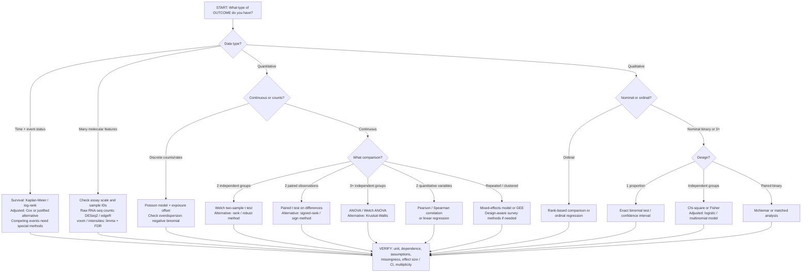

# Basics of Computational Statistical Biology

**From data type to statistical test: an R-based biomedical decision guide**  
**Paul's Notes | Independent teaching guide | Reviewed 2026-10-22**  
**Scope:** Biomedical, clinical, public-health and cancer research across all cancer types. Breast cancer examples are illustrations, not a limit on the guide.  
[Learning home](README.md) · [Recent literature and R workflows](../06_RESOURCES/Literature/BIOSTATISTICS_R_LITERATURE_2021_2026.md) · [R tools](../06_RESOURCES/R/README.md) · [Study protocol](../templates/study-protocol.md) · [Research/data boundaries](../docs/research-workflow.md)

**Start here: What type of data are we working with — quantitative (numerical), qualitative (categorical), counts, or time-to-event?** Identify what is measured *before* looking up a t-test, chi-square test or regression model. Then refine the choice by the question, number of groups, pairing and sampling design.

> Teaching guide, not an automatic test recommender or clinical decision-support system. All examples are synthetic. Do not put protected records, identifiers or restricted cancer data in this public repository.

## 1. First classify the data

| Family | Type | What it means | Biomedical example | In R |
| --- | --- | --- | --- | --- |
| **Quantitative** | **Continuous** | A measurable number on a scale; decimals may be meaningful | Blood pressure (mmHg), serum creatinine, cell size, log2-transformed expression | Usually `numeric`; inspect units and measurement scale |
| **Quantitative** | **Discrete count** | Nonnegative integer numbers of events or objects | Hospital visits, infections, sequencing read counts | Usually `integer`/`numeric`, **but interpreted as counts** |
| **Qualitative** | **Nominal: binary** | Exactly two unordered categories | Tumor present/absent, treatment/control, ER-positive/negative | `factor` with two levels (or justified 0/1 outcome for a model) |
| **Qualitative** | **Nominal: 3+ levels** | Three or more unordered categories | Molecular subtype, blood type, diagnostic category | `factor` |
| **Qualitative** | **Ordinal** | Categories have a meaningful order but not necessarily equal spacing | Cancer stage I–IV, toxicity grade, mild/moderate/severe | `ordered` factor with specified order |
| **Special endpoint** | **Time-to-event** | Duration **plus** whether an event happened or the record was censored | Time to recurrence with loss-to-follow-up status | `time` numeric + `event` indicator; use `Surv()` |

**Do not mistake storage for science.** A cancer stage coded `1, 2, 3, 4` is **ordinal**, not an interval-scale measurement merely because it uses numbers. A specimen ID written as `101` is an **identifier**, not a continuous measurement. Raw RNA-seq reads are **counts**; log2 expression values may be continuous measurements, but transformed expression must **not** be fed back into a raw-count model.

**Overlay that changes the test, but is not a data type:** independent patients versus the same patients before/after; specimens nested within donors; repeated visits within sites; repeated cells within one specimen; and stratified/clustered survey sampling. Also ask whether the variable is the **outcome** or an **explanatory group/predictor**.

### Simplest examples

- **Continuous outcome + categorical group:** Does mean blood pressure differ between independent treatment groups? Start with **Welch two-sample t-test**, or an appropriate adjusted/robust model.
- **Two continuous variables:** Does age vary with biomarker concentration? Begin with a scatterplot, then **Pearson or Spearman association** or regression as justified.
- **Two categorical variables:** Is disease status associated with exposure group? Start with an independent **chi-square/Fisher contingency-table analysis**, after checking counts and design.
- **Paired binary outcome:** Did disease-positive status change in **the same people**? Use a **McNemar** approach, not an independent chi-square test.
- **Event counts:** How does the infection rate change per person-year? Start with **Poisson regression with a log-exposure offset**, assess dispersion and consider negative binomial.
- **Time plus censoring:** Does recurrence-free survival differ? Start with **Kaplan–Meier/log-rank** descriptively; consider Cox or another prespecified model for adjusted association.

## 2. Data-first statistical test flowchart

Read from the **measured outcome**, then use pairing/grouping and study assumptions to refine the choice. Statistical questions can be descriptive, comparative, associative or predictive; this tree is an **entry point**, not a substitute for the study protocol.



**Decision hierarchy:** (1) measured outcome **type** → (2) one, two or many groups / explanatory variables → (3) **independent, paired or clustered** design → (4) scientific estimand and assumptions → (5) statistical procedure → (6) estimate, confidence interval, diagnostics and defensible interpretation.

## 3. Quick fundamentals: descriptive statistics come before testing

| Data type | What to summarize first | First plot | Inferential quantity |
| --- | --- | --- | --- |
| Continuous | `n`, missing, mean, SD, median, IQR, min/max | Histogram, box/violin with data points, Q–Q or scatterplot | Mean difference, coefficient, correlation and CI |
| Discrete counts | `n`, zeros, median/range, event total, **exposure time** | Count bar chart or count distribution | Rate ratio or count-model coefficient and CI |
| Nominal | Group counts, denominators, proportions | Bar plot with denominators | Risk difference/ratio, odds ratio or association with CI |
| Ordinal | Counts in each ordered grade, cumulative proportions | Ordered bars / stacked bars | Ordinal odds ratio or distribution/rank contrast |
| Time-to-event | At-risk counts, events and censored records, follow-up | KM curve with at-risk table | Survival probability at a horizon, hazard ratio or cumulative incidence |

### Two important distinctions

**Parametric versus nonparametric is not simply normal versus non-normal.** Parametric models specify a model family and estimand (for example a mean difference); rank methods answer a potentially different question (relative distributions). A Shapiro–Wilk p-value on raw values is **not** a universal switch between t-tests and Wilcoxon tests. Examine the study design, shape, influential values and how you intend to interpret the estimate.

**A statistical test does not replace a model.** With confounders, predictors, multiple groups, repeated observations, different follow-up times or multiple tested genes, choose a justified regression, longitudinal, survival or genomic modeling framework. A significant association by itself does not establish causation or clinical usefulness.

### Read and classify columns in R

```r
# Synthetic, illustrative types; no real participant data.
types <- data.frame(
  specimen_id = c("A01", "A02", "A03", "A04"),
  glucose_mg_dl = c(89.1, 102.5, 95.2, 110.0),
  infection_count = c(0L, 1L, 3L, 1L),
  disease = factor(c("No", "Yes", "No", "Yes")),
  stage = ordered(c("I", "II", "I", "III"),
                  levels = c("I", "II", "III", "IV"))
)
str(types)
summary(types)
table(types$disease, useNA = "ifany")
table(types$stage, useNA = "ifany")
hist(types$glucose_mg_dl, main = "Invented glucose values",
     xlab = "mg/dL")
```

This gives a beginner a concrete distinction between `numeric`, `integer`, `factor` and `ordered`. A real study must preserve original categories and units, validated IDs, missingness and sample definitions.

## 4. Then identify the scientific question and design

1. **Aim:** Describe a distribution? Compare groups? Estimate association? Predict disease? Study survival? Make a causal claim only with appropriate design and assumptions.
2. **Outcome and predictors:** Which variable is being explained, and which variables are groups/exposures? Their combination matters: quantitative outcome + categorical group commonly leads to a mean model; binary outcome + quantitative predictors commonly leads to logistic regression.
3. **Unit of independence:** Patient, donor, animal or study site? Technical replicates, cells and paired tissue samples are not automatically independent.
4. **Number of groups and pairing:** One proportion; two independent means; two paired measures; three independent groups; repeated visits; nested sites?
5. **Target estimate:** Mean difference, odds ratio, risk difference, incidence-rate ratio, correlation, hazard ratio or prediction risk at a horizon?
6. **Validity:** Missing data, unequal variances, distribution shape, sparse cells, confounding, survey weights, censoring, multiplicity, code reproducibility and privacy?

**Worked choice:** You record ESR1 expression (continuous transformed assay value) for matched tumor and normal specimens from each person. The *measurement* is continuous, but the **pairing** determines the initial two-condition analysis (paired mean difference / suitable paired alternative). For raw gene-level RNA-seq counts across the entire transcriptome, use an assay-appropriate count model with participant blocking and multiplicity correction instead.

## 5. Data-type-to-test reference: common biomedical questions

| Question / outcome | Data structure | Starting method in R | What to report / watch |
| --- | --- | --- | --- |
| Mean biomarker, 2 groups | Independent people, continuous | `stats::t.test(y ~ group, data = d)` (Welch default) | Mean difference, 95% CI; inspect residual/outlier structure; do not assume equal variances |
| Change in biomarker, 2 visits | Same people/specimens paired | `stats::t.test(before, after, paired = TRUE)` | Pair count and **difference** distribution, mean change and CI; preserve IDs |
| Skewed continuous outcome, 2 groups | Independent; rank/distribution target | `stats::wilcox.test(y ~ group, data = d)` | Rank/distribution interpretation; not automatically a median test |
| Skewed paired outcome | Paired; suitable difference distribution | `stats::wilcox.test(before, after, paired = TRUE)` | Signed-rank assumes suitable symmetric differences for location interpretation; sign test otherwise |
| Mean biomarker, 3+ groups | Independent, continuous | `stats::aov(y ~ group, data = d)` or `stats::oneway.test(y ~ group, data = d)` | Global test, prespecified contrasts; Welch version for unequal variance |
| Rank-oriented 3+ group comparison | Independent groups | `stats::kruskal.test(y ~ group, data = d)` | Does not handle clustering or estimate a mean effect; post hoc adjustment |
| 2 categorical variables | Independent observations | `stats::chisq.test(tab)` or `stats::fisher.test(tab)` | Cell counts and expected frequencies; risk difference/RR/OR with CI as appropriate |
| Before/after binary response | Matched binary pairs | `stats::mcnemar.test(tab)` | Discordant pairs; matched effect size; verify table orientation |
| Adjusted continuous association | Person-level continuous response | `stats::lm(y ~ exposure + age + site, data = d)` | Coefficients with units/CI; residuals, functional form and confounding |
| Adjusted binary event | Person-level yes/no response | `stats::glm(event ~ exposure + age, family = binomial(), data = d)` | Odds ratios (not risk ratios), CI, calibration/separation diagnostics |
| Count of events per follow-up time | Independent count data, unequal exposure | `stats::glm(n ~ exposure + offset(log(person_time)), family = poisson(), data = d)` | Incidence-rate ratio and CI; overdispersion, excess zeros and time denominators |
| Ordered severity category | Ordinal endpoint | `ordinal::clm(y ~ exposure, data = d)` | Proportional-odds check; ordered categories and OR scale |
| Measurements across visits/sites | Longitudinal or clustered | `lme4::lmer(y ~ group * time + (1 | id), data = d)`; `geepack::geeglm()` | Within-person/site correlation; fit, convergence, working correlation; enough clusters |
| Correlation of 2 quantitative variables | Independent pairs | `stats::cor.test(x, y, method = "pearson")` / `"spearman"` | Correlation and CI where supported; scatterplot, outliers, nonlinearity; correlation is not causation |
| Unadjusted time-to-event comparison | Censoring, known time origin | `survival::survfit(Surv(time, event) ~ group, data = d)`; `survival::survdiff()` | KM curves at-risk table; log-rank p-value, not just median survival |
| Adjusted time-to-event association | Censored event-time outcome | `survival::coxph(Surv(time, event) ~ group + age, data = d)` | Hazard ratio and CI; proportional hazards checks; censoring mechanism |
| Competing-risk event probability | Competing events preclude outcome | Cumulative-incidence methods, e.g. `cmprsk::cuminc()` | Cumulative incidence (not 1–KM with competing events simply censored) |
| Many RNA-seq genes, two groups | Raw read counts, biological replicates | `DESeq2` / `edgeR` with design and contrasts | Raw-count assay model, gene-level log2 fold changes, adjusted p-values and QC |
| Microarray / voom RNA-seq | Suitable normalized intensities or voom inputs | `limma` | Correct assay transformation, contrast, empirical-Bayes fit, FDR |
| Disease prediction / classification | Prespecified target and evaluation units | `tidymodels` or `caret` / other validated pipeline | Group-safe nested evaluation, AUC and calibration, CIs, subgroup checks |

**One sample:** A one-sample t-test compares a quantitative mean with a prespecified benchmark (`t.test(x, mu = target)`); a binomial test addresses a single proportion (`binom.test(successes, total)`). **More than two time points:** prefer mixed/repeated-measures approaches after checking the covariance assumptions, dropout and study design. **Two predictors:** Pearson or Spearman applies to association; choose regression if direction, adjustment, time structure or a response model is needed.

## 6. The assumptions and design gates

- **Independence first:** a large sample size cannot repair pseudoreplication. Technical replicates, longitudinal observations and tumor/normal specimens from one person need ID-aware methods. Random-effects models and GEEs answer related but distinct conditional vs population-average questions.
- **Outcome scale and estimand:** a t-test addresses means; a rank-sum test generally addresses relative distributions/stochastic ordering, and only under extra shape/location assumptions can be translated into a median/location claim.
- **Distribution:** residual structure, skew, heavy tails and outliers matter. Assess them visually and scientifically. Do **not** apply Shapiro-Wilk to every raw variable and switch tests mechanically at `p < 0.05`.
- **Variance:** for independent groups, Welch t-test is a useful default for means; unequal variances also affect ANOVA and some rank-test interpretations.
- **Sparse categorical tables:** inspect actual counts and expected frequencies; choose Fisher or suitable exact/model-based methods when asymptotic chi-square is unreliable. Huge sparse/multilevel tables need deliberate modeling.
- **Missing data:** report missingness by group and stage; assess plausible missingness mechanisms, reasons, and sensitivity analyses. Complete-case and multiple-imputation assumptions are **not** interchangeable; do not recode NA as zero.
- **Confounding and study design:** exploratory comparisons do not establish causation. For nonrandomized exposures, specify a causal design/estimand, variables and adjustment strategy before fitting models.
- **Multiplicity:** prespecify families and contrasts. Holm controls familywise error; Benjamini-Hochberg (`p.adjust(p, "BH")`) targets FDR under its required assumptions. An adjusted p-value is not a magnitude of clinical effect.
- **Time-to-event:** define time zero, eligibility, censoring and event type; assess proportional hazards for Cox; distinguish cause-specific hazards from subdistribution hazards when competing events occur.
- **Survey weights and design:** use `survey::svydesign()` and survey-aware analyses when sampling involves clusters, strata, or weights; ordinary GLM standard errors are not necessarily valid.
- **High dimensionality:** check design rank, donor/batch effects, features relative to participants, multiplicity and train/test contamination. Do not derive feature selection on an evaluation fold.
- **Clinical significance:** a low p-value is not proof of a useful treatment effect. Report the effect, uncertainty, absolute risks where relevant and an interpretable threshold.

See [Chicco et al. (2025)](https://doi.org/10.1186/s13040-025-00465-6), [Muhammad (2023)](https://doi.org/10.1172/JCI171058), [Rahnenführer et al. (2023)](https://doi.org/10.1186/s12916-023-02858-y), and [Gurski and Dittel (2026)](https://doi.org/10.1093/immhor/vlaf072). Those papers explain important subsets of these decisions; the above is an independently prepared synthesis, not a universal algorithm endorsed by the papers.

## 7. Worked decisions from cancer research

### A. Tumor versus normal specimens from the same person
**Question:** Is an assay-derived continuous biomarker different between paired specimens?  
**Unit:** Person; two linked specimens per person. **Start:** paired t-test on person-level differences if the mean-change estimand and assumptions fit, or an appropriate paired robust/rank analysis. Do **not** use the independent two-sample t-test. Include the number of complete pairs and the distribution of differences. For genome-wide raw RNA-seq count testing, use `DESeq2` / `edgeR` with patient blocking, design matrix and FDR rather than thousands of unadjusted paired t-tests.

### B. ESR1 / ERBB2 expression and tumor subtype
**Question:** Is a continuous expression measurement associated with a subtype factor across independent patients?  
**Unit:** Person (check for multiple specimens). **Start:** 2-group Welch or a multi-group linear model with prespecified contrasts, adjusting for relevant design variables; consider `limma` for appropriate high-throughput expression scales. Subtype should not be inferred from the very marker then treated as an independent label without explaining circularity. Batch confounding may make a simple unadjusted test indefensible.

### C. 24-month outcome and censored follow-up
**Question:** How do survival and prediction errors vary over follow-up?  
**Unit:** Person, with explicit event/censoring records and baseline time origin. **Start:** KM/log-rank for descriptive unadjusted survival contrasts and Cox or alternative survival models for covariate associations; use censoring-aware prediction metrics at the prespecified horizon where required. **Do not alter** the separate frozen [G4 synthetic survival protocol](../04_machine_learning/survival-protocol.md); this guide is not G4 implementation evidence or permission to reinterpret a Brier score as a p-value test.

### D. Clinical sites measuring a repeated biomarker
**Question:** Does an intervention-by-time association persist while accounting for clustering?  
**Unit:** People within sites, repeated visits. **Start:** mixed-effects model or GEE with a scientifically defensible correlation structure, adequate cluster count and sensitivity assessment. If randomized by site, a simple row-level t-test incorrectly treats every visit as an independent randomization.

## 8. R examples: transparent, minimal calls

These are **API patterns**, not commands to run against unidentified data. `d` must be a reviewed data frame with correct types, factor levels, units, person identifiers, and protocol-approved outcomes.

```r
# Independent mean difference: Welch is the default
fit_mean <- stats::t.test(marker ~ group, data = d)

# Paired mean difference: before and after vectors must be matched by ID first
fit_paired <- stats::t.test(d$before, d$after, paired = TRUE)

# Independent binary categorical response: confirm table counts first
tab <- table(d$group, d$event)
fit_2x2 <- if (any(chisq.test(tab)$expected < 5)) {
  stats::fisher.test(tab)
} else {
  stats::chisq.test(tab, correct = FALSE)
}
# Threshold above is an illustrative screening rule, not a sufficient universal
# algorithm. Use appropriate methods when table size or design requires them.

# Adjusted associations
fit_cont <- stats::lm(marker ~ group + age, data = d)
fit_binary <- stats::glm(event ~ group + age, data = d,
                         family = stats::binomial())

# Prespecified multiple-testing family; report its definition
adjusted_p <- stats::p.adjust(p_values, method = "BH")

# Session audit (record this alongside study inputs and output checks)
utils::sessionInfo()
```

**Caution:** The paired vectors above are safe only **after** a checked ID join and complete-pair selection; ordering rows separately can silently fabricate pairs. `glm(..., family = binomial())` estimates log odds; exponentiation yields odds ratios, not risk ratios. For complex survey or clustered data, the above simple examples are insufficient.

The repository already provides [keys and reshaping](keys-and-reshaping.md), [missingness and comparisons](missingness-and-comparisons.md), [models and uncertainty](models-and-uncertainty.md), and [R statistical visualizations](../06_RESOURCES/R/README.md). Use those as prerequisites.

## 9. R biomedical deployment: from analysis to an auditable deliverable

**Minimal architecture (no clinical deployment claim):**


| Layer | R / engineering option | Acceptance criterion |
| --- | --- | --- |
| Project environment | `renv` lockfile; explicit R and Bioconductor versions | Clean-machine restore produces a declared environment |
| Analysis dependencies | `targets` DAG for incremental pipelines | All targets run from permitted input fixtures; provenance trace exists |
| Data checking | base R + `testthat` checks, typed dictionaries | Reject duplicate IDs, invalid event coding, negative follow-up and inconsistent dimensions |
| Study modeling | `stats`, `survival`, `lme4`, `geepack`, `survey`, `DESeq2` / `edgeR` as appropriate | Independent numerical fixtures and model-specific diagnostic review |
| Tables / figures | `gtsummary`, `broom`, `ggplot2` | Denominators, units, confidence intervals and adjustment are explicit |
| Reports | Quarto or R Markdown | Executable source, frozen parameter set and traceable outputs |
| CI and software release | GitHub Actions + regression / smoke checks; optional `rworkflows` | Test logs and reviewed package versions retained; no secrets in artifacts |
| Interactive teaching | `shiny` on synthetic/aggregated outputs | No participant-level payloads in HTML, server logs, API responses or downloads |

Suggested **locally reviewed** sequence (package installs are intentional, not automatic):

```bash
# In an approved R project; install desired packages separately first
Rscript -e 'renv::restore(prompt = FALSE)'   # only with a reviewed renv.lock
Rscript -e 'targets::tar_make()'              # only if _targets.R exists
quarto render report.qmd                     # only if a reviewed report exists
git diff --check
git status --short
```

Do not add placeholders to an existing project and pretend the pipeline has run. In this repository, these are proposed integration patterns; no validated clinical deployment or new R runtime execution is asserted by this document. For package validation and CI evidence see [biomedical coding gates](../02_biomedical_coding/IMPLEMENTATION_GATES.md) and [primary R reference material](../02_biomedical_coding/PRIMARY_DOCUMENTATION.md).

## 10. Reporting checklist before publication

- [ ] Protocol states primary/secondary outcome, comparison, estimand and study design before examining results.
- [ ] Independent unit, participant/specimen/visit hierarchy, group counts, missingness and exclusions are stated.
- [ ] Measurement units, transformed scales, categories, event coding, follow-up origin, censoring are defined.
- [ ] Chosen model and alternatives are justified by assumptions, dependence, and required adjustment.
- [ ] Effect estimate, confidence interval and meaningful interpretation accompany p-values when applicable.
- [ ] Multiplicity family and correction, sensitivity/subgroup status and all exclusions are explicit.
- [ ] Diagnostic findings, model convergence, influential points and robustness are recorded.
- [ ] R version, packages/lockfile, code revision, inputs, seeds and reproducible commands are captured.
- [ ] Independent reviewer can recreate tables/figures from eligible inputs without manual spreadsheet editing.
- [ ] Privacy, participant licensing, release authority and small-cell/interactive-export disclosure risks are checked.

For trials use [CONSORT 2025](https://doi.org/10.1136/bmj-2024-081123); for prediction modeling use [TRIPOD+AI](https://doi.org/10.1136/bmj-2023-078378). Reporting checklists are **not** automatic proof that a statistical method is appropriate.

## 11. Further reading and review status

The [recent methods / R / deployment evidence review](../06_RESOURCES/Literature/BIOSTATISTICS_R_LITERATURE_2021_2026.md) links original publications, year, DOI, contribution, and what each source **does not** validate. Its companion [CSV register](../06_RESOURCES/Literature/biostatistics_r_literature_2021_2026.csv) supports filtering and future source-check passes. This is a **curated narrative review**; it is not a PRISMA systematic search or a reproduced analysis of every paper.

**Evidence boundary:** source metadata and article conclusions were checked against publisher / PubMed or journal pages during the 2026-10-22 review. No independent replay of published results or execution of the example code is claimed by this addition. Consult the original paper, up-to-date package manual and local statistical reviewer for any new use.
