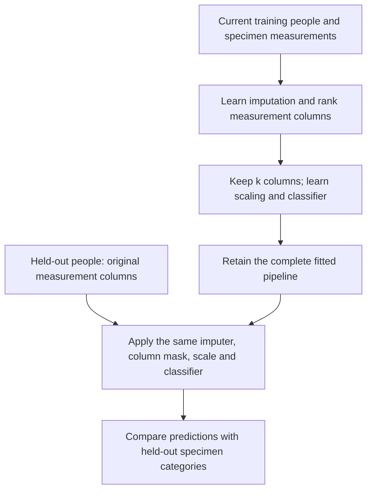

# Advanced training and selecting informative measurements

[Breast cancer book: research question](../06_RESOURCES/Genomics/BREAST_CANCER_60_GENE_COMPANION.md#applying-machine-learning-to-breast-cancer-data) · [Visual data guide](visual-data-guide.md) · [Machine learning subjects](README.md)

Return to the book's question: **could molecular measurements distinguish a recorded tumor specimen from its comparator in previously unseen people?** We now ask whether a smaller set of measurements can support that task, how to select it without seeing assessment answers, and what a ranked variable list actually means. A recurrence forecast, treatment-response estimate, or survival question would need a different target and assessment design.

All numerical deployments linked here use synthetic data. The book's 60 genes remain a teaching catalog with the evidence states recorded in its gene cards; this chapter does not turn them into a fitted signature.

## Slice rows to assess; slice columns to select variables

Rows identify observations. Columns hold the measurements we might use. First reserve people for assessment. Then, inside each training slice, choose the measurement columns and fit a predictor.

| Stage | Rows available for learning | Columns available to the model |
| --- | --- | --- |
| Study table | Authorized people and linked specimens | Assay features, metadata, target and identifiers have distinct roles |
| Inner training fold | Only the current training people | Candidate measurement columns; identifiers and target excluded from X |
| Feature selection | Same inner training people | Rank candidate columns and retain the selected subset |
| Inner validation | Different development people | Apply the retained column selection and transformations unchanged |
| Outer assessment | People excluded from the entire inner search | Apply the tuned pipeline; score its held-out predictions |
| Final test | People reserved before development | Apply the final development-fitted procedure without selecting again |

Selecting the “top 10” genes across the full cohort before making these divisions lets assessment outcomes influence the predictor. Selecting 10 inside each training fit evaluates the **selection procedure**, including its tendency to choose different genes with different people.



**Text equivalent:** Both the ranking and the predictor are learned inside training. Held-out records pass through the retained pipeline. The value of k is itself a setting selected within development; it cannot be chosen using the final test score.

## What does “important” mean in the breast cancer story?

A feature can be useful for separating tissue categories because it tracks receptor expression, proliferation, immune cells, stromal content, assay batch, or specimen handling. Predictive value alone does not identify which explanation is correct. Return to the book's [measurement and interpretation guide](../06_RESOURCES/Genomics/GENE_EXPRESSION_INTERPRETATION.md) and the relevant gene card before proposing a mechanism.

| Quantity | What it answers | How to read it here |
| --- | --- | --- |
| Training-only univariate rank | Which measurements individually distinguish the current training labels under the chosen score? | A screening heuristic; it can miss interactions and keep redundant correlated features |
| Standardized logistic coefficient | How does the fitted log-odds score change with one standardized feature, holding the other selected inputs fixed? | Direction and magnitude depend on scaling, penalty, correlations and selected columns |
| Held-out permutation importance | How much does this fitted procedure's score worsen when one input column is shuffled? | Dependence of this model on that measurement under the specified shuffle and score |
| Selection frequency across outer fits | How often does the procedure retain a feature when the training people change? | A descriptive sensitivity check; three outer fits cannot establish a stable clinical panel |
| Differential-expression effect and adjusted p-value | What expression contrast is supported under a specified inferential model? | A separate association analysis; it does not supply independent predictive validation |

ESR1 and PGR, for example, belong in the book's receptor narrative; CD8A and COL1A1 lead readers toward immune and stromal context. These links explain possible questions to investigate. No importance rank or predictive result for these named genes is asserted here.

Correlated genes can substitute for one another. A small permutation score for one gene can coexist with a useful correlated group. Shuffling can also create combinations rarely seen in real specimens. Compare ranks across training fits and consider prespecified pathway-level questions. An importance bar is neither a causal effect nor a recommendation to alter that gene.

## Ways to choose a smaller measurement set

| Method | Breast cancer application to consider | Training boundary and tradeoff | Status here |
| --- | --- | --- | --- |
| Prespecified panel | Test a panel justified by external evidence before examining this cohort's outcomes | Record rationale and assay compatibility; still fit preprocessing and evaluate on held-out people | Design pattern; the book's 60 genes are not a validated panel |
| Top-k filter | Retain the k highest-ranked candidate measurements for a tissue-category predictor | Rank inside every training fit; tune k inside the inner loop | Executed synthetic example below |
| L1 or elastic-net regularization | Shrink a high-dimensional predictor; some settings produce sparse coefficients | Tune penalties within development; correlated measurements and scaling affect the selected set | Elastic-net fitting in [caret](caret-deployment.md); panel stability is an extension |
| Recursive feature elimination | Refit and remove measurements repeatedly | Put the entire elimination and subset-size search inside resampling; repeated fitting can be expensive | Reference pattern |
| Pathway aggregation or PCA | Compress related expression measurements before prediction | Learn any cohort-dependent weights within training; preserve a documented interpretation of the representation | PCA in [Python methods](methods-and-deployments.md); pathway aggregation is a reference pattern |

Ranking is a modeling step, not a discovery claim. In the paired synthetic example, the F-based screen is used solely as a ranking heuristic. Its univariate p-values do not account for within-person pairing and are not exported or interpreted as gene-discovery evidence.

## Executable example: selecting columns while holding people apart

The [feature-selection deployment](examples/breast_cancer_feature_selection.py) constructs **60 invented people, each with one simulated tumor-labeled and one comparator-labeled specimen**. There are 48 arbitrary assay features, with simulated signal in the data-generating mechanism. They are called `Feature001` onward to avoid assigning invented effects to real genes. The values are synthetic continuous assay measurements, not RNA-seq counts.

It reserves 15 people and all 30 of their specimens for the final test. The remaining 45 people and 90 specimens enter three outer folds. Each outer training set has 30 people and 60 specimens; its three inner folds train on 20 people and validate on 10. Specimens from a person stay together at both levels.

The pipeline is median imputation → top-k selection → standardization → regularized logistic regression. It searches k = 5, 10, or 20 and C = 0.1 or 1.0 using inner-fold negative Brier score. These are six candidates, not six independently validated studies. A final search on all development people refits the complete pipeline before predicting the reserved test specimens.

From the repository root, using the [pinned Python dependencies](requirements-python.txt):

```bash
python3 04_machine_learning/examples/breast_cancer_feature_selection.py /tmp/breast-cancer-feature-selection
python3 04_machine_learning/tests/test_breast_cancer_feature_selection.py
```

Choose a new output directory outside the repository with an existing parent. The output contains:

| File | What the learner can inspect |
| --- | --- |
| `synthetic_inputs.npz` | Measurements, targets, specimen IDs, person IDs and feature names |
| `report.json` | Full-cohort development/test rows; inner/outer membership; chosen settings; outer-held-out and test predictions, metrics and development-prevalence test baseline |
| `feature_review.csv` | Final selected columns, standardized coefficients, selection counts across three outer fits and mean outer-assessment permutation score changes |
| `pipeline.joblib` | Final fitted imputer, selector, scaler and model for replay |
| `versions.json`, `sha256.json`, `README.txt` | Runtime, file integrity and interpretation records |

All split indices in this deployment are **zero-based full-cohort row positions**, including inner folds. This is different from the development-local fold coordinates used by the earlier Python example. Use the specimen and person arrays to recover identities; never infer identity from a row number alone.

The permutation diagnostic uses five row-wise shuffles per feature on each outer assessment slice. A positive change means worse Brier error after shuffling. These are descriptive perturbations of specimen measurements; shuffling does not preserve within-person feature dependence. Their mean is not a population effect, confidence interval, or second feature-selection rule. The final test is not used to rank variables. Any further procedure chosen after inspecting these diagnostics requires its own assessment.

The fixture gives each person the same two specimen categories. This balances those labels by construction and supports a paired tissue-category illustration. It does not represent the prevalence, eligibility, or case mix of a breast cancer screening population. Performance metrics here weight specimens equally; because every person has exactly two specimens, each person also contributes the same total weight. Unequal specimen counts would require an explicit weighting or aggregation decision. No patient-level uncertainty intervals or clinical performance targets are supplied.

## Advanced training methods: what each adds to this research question

| Method | How it changes training | Breast cancer narrative and required assessment | Status here |
| --- | --- | --- | --- |
| Nested grouped tuning | An inner loop chooses settings; an outer loop assesses that search on different people | Tune assay-column selection without allowing paired specimens to cross boundaries | Executed in the selection example |
| Randomized or adaptive search | Evaluate a bounded subset of settings or allocate more fitting budget to promising candidates | Useful when the expression pipeline has a large search space; keep a fixed budget and independent outer assessment | Reference; adaptive stopping must respect group/class structure |
| Repeated grouped resampling | Rebuild partitions to inspect sensitivity to the sampled people | Examine whether the selected measurement set and predictions change across patient allocations | Reference; overlapping resamples do not create independent cohorts |
| Boosting with early stopping | Add weak learners sequentially; stop using a development assessment rule | Test nonlinear specimen patterns; keep the stopping split separate by person and inside outer training | Boosting runs in [Python methods](methods-and-deployments.md) with early stopping disabled; grouped stopping is an extension |
| Stacking | Train a combining model on out-of-fold predictions from base models | Combine molecular and clinical predictors only if the combiner's training predictions were generated without fitting those people's outcomes | Reference; ordinary in-sample base predictions leak fitting information into the combiner |
| Probability calibration and threshold selection | Fit a probability correction or choose an action threshold within development | A tissue-label score needs probability assessment; any clinical action also needs its own intended-use and utility evidence | Calibration plots exist; fitting a calibrator/threshold workflow is an extension |
| Transfer learning and multimodal fusion | Reuse a pretrained representation or combine assay/image/clinical views | Check patient overlap with pretraining, missing modality rules, assay compatibility, and site/time transfer | [Paper-to-code studies](recent-code-studies.md); no local neural or multimodal deployment |
| Penalized survival learning | Fit censored event outcomes with regularization rather than collapsing follow-up to a binary label | For recurrence questions, define time origin, event, censoring and horizon first | Direct Cox example exists; penalized high-dimensional survival tuning is an extension |

Choose an extension because it answers an unresolved part of the study question. A small number of independent people limits what an extensive search can establish. Hold sites or future time periods apart when transport to those settings is the goal; the synthetic person split does not test those claims.

## Bring the result back into the book

A complete report would say: “We selected measurements and tuned the predictor using development people only. All related specimens stayed together. We report the panel selected by the final development fit, its sensitivity to training membership, and performance on people excluded from all development decisions.” Fill in actual counts and results only after execution and review.

Then return to [Chapter 11](../06_RESOURCES/Genomics/BREAST_CANCER_60_GENE_COMPANION.md#chapter-11-working-through-a-research-question): What category did the assay predict? Could tissue composition or batch explain a useful feature? Would the same measurements be available at the proposed prediction time? Which external cohort or experiment could test the next claim? The selected features are a computational result; biological interpretation needs the evidence and limitations in the gene cards.

Primary implementation guidance: [feature selection](https://scikit-learn.org/stable/modules/feature_selection.html), [permutation importance](https://scikit-learn.org/stable/modules/permutation_importance.html), [nested evaluation](https://scikit-learn.org/stable/auto_examples/model_selection/plot_nested_cross_validation_iris.html), [ensemble methods](https://scikit-learn.org/stable/modules/ensemble.html), and [probability calibration](https://scikit-learn.org/stable/modules/calibration.html). These explain methods; they do not validate this synthetic example as a breast cancer predictor.
