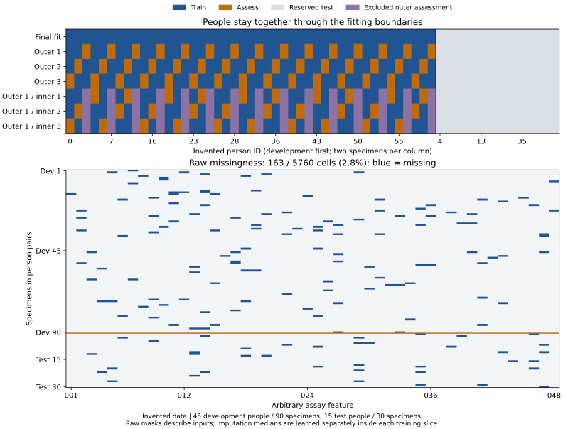
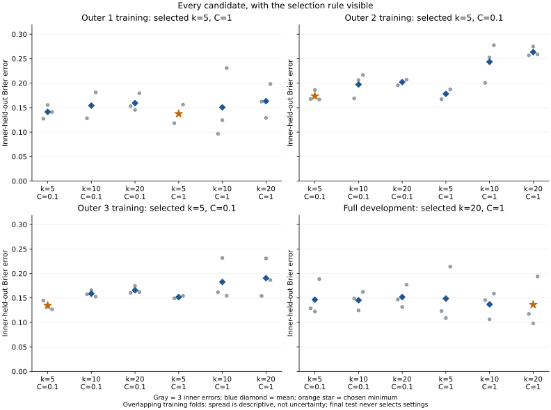
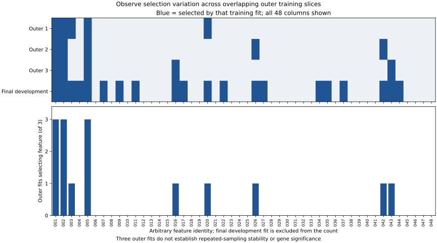
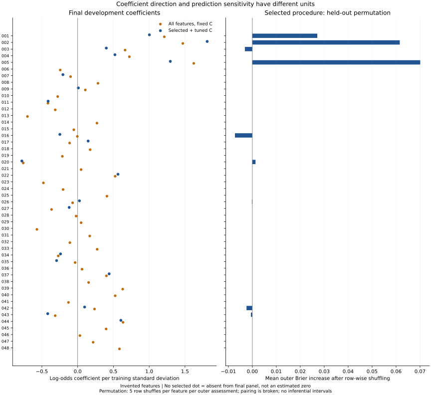
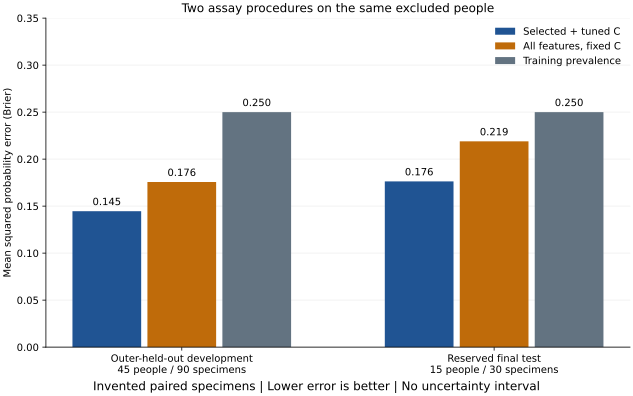
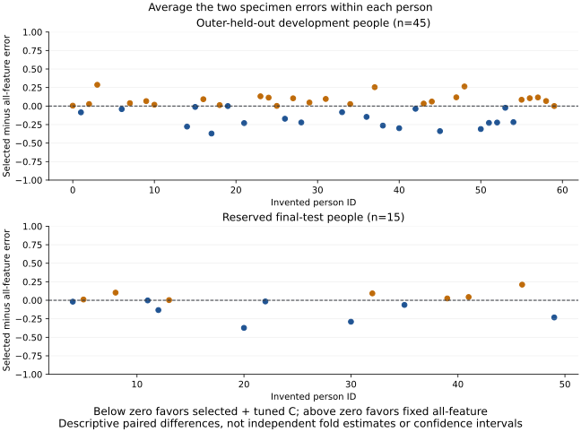
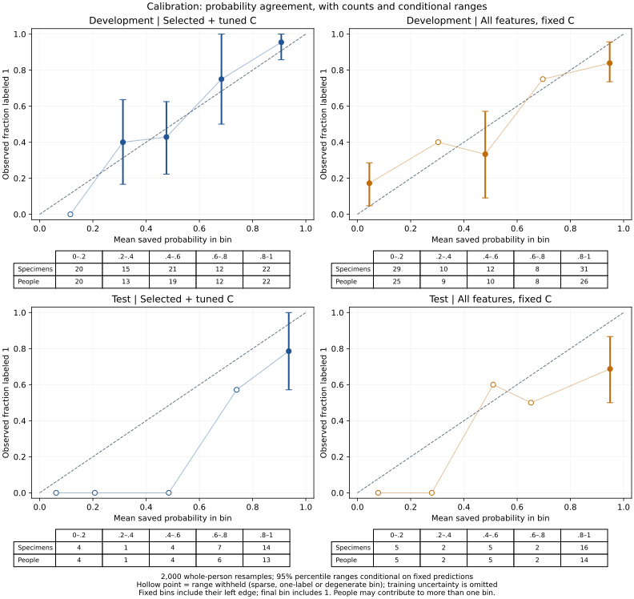

# Machine learning plotting gallery

[Breast cancer narrative](../../06_RESOURCES/Genomics/BREAST_CANCER_60_GENE_COMPANION.md#applying-machine-learning-to-breast-cancer-data) · [Comparison guide](../model-comparison.md) · [Data-flow diagrams](../visual-data-guide.md) · [Broader visualization resources](../../06_RESOURCES/SPECIALIST_VISUALIZATIONS.md)

Follow the book's question: can molecular measurements distinguish a recorded specimen category for previously unseen people? These seven figures show where the data went, what training selected, and how the excluded specimens were predicted. The version 1 teaching draw contains **60 invented people, two specimens each, and 48 arbitrary assay features**. These are not the book's named genes or clinical results.

Every figure is computed from the [saved comparison report](example/report.json), [specimen probabilities](example/predictions.csv), and [missingness/feature summaries](example/display-inputs.json). The [plot calculations](example/plot-data.json), [runtime versions](example/versions.json), source hashes and [snapshot manifest](example/manifest.json) identify the displayed example. The [training protocol](../comparison-protocol.md) and [figure/uncertainty contract](plotting-contract.md) separate the training choices from descriptive displays.

| Subject | Start here | Status |
| --- | --- | --- |
| Person/specimen allocation and missingness | [Trace the training slices](#trace-the-training-slices) | Available |
| Inner candidate scores and selected settings | [Read the tuning decisions](#read-the-tuning-decisions) | Available |
| Feature-selection stability and coefficient/importance contrasts | [Inspect feature inclusion](#inspect-feature-inclusion), then [compare feature summaries](#compare-feature-summaries) | Available; three-fit variation only |
| Matched probability errors | [Compare probability error](#compare-probability-error) | Available |
| Within-person error differences | [Inspect differences within people](#inspect-differences-within-people) | Available |
| Calibration with counts and uncertainty treatment | [Read probability agreement](#read-probability-agreement) | Available; conditional ranges |

## Trace the training slices



**Read the cells:** Each column in the upper panel is one person with two specimens. Development people appear first; the reserved 15 people remain gray throughout. Blue means that slice trains the model; orange means it assesses predictions. The three inner rows illustrate the first outer search: purple people are excluded by its outer assessment and cannot enter that search. The other outer searches and final development search retain their own inner coordinates in the report.

In the lower panel, one cell is one specimen/feature measurement before imputation; blue means missing. Specimens remain adjacent within people, with development above the orange boundary and test below. There are **125 missing cells out of 4,320 development measurements** and **38 out of 1,440 test measurements**. The 120 specimens are not 120 independent people. The full synthetic cohort passes its identity/eligibility contract; this figure adds no exclusions.

**Interpret:** A training median must be learned again inside each blue slice, along with feature selection and scaling. Inspecting missingness in a reserved specimen does not authorize using it to learn that median. A missingness pattern can suggest a question for a future analysis, but the synthetic mask supplies no evidence about causes of missing breast cancer measurements.

**Try:** Trace one orange outer-assessment person through the corresponding inner rows. Recover both specimen IDs from `predictions.csv`, locate their masks, and explain why neither specimen can appear in those inner training fits.

## Read the tuning decisions



**Read the axes:** Each panel is a separate search: one within each outer training slice, then one on all development people. Six k/C candidates appear in the same order. Gray dots are individual inner-held-out errors, blue diamonds their arithmetic means, and the orange star the saved chosen minimum. Lower Brier error is better; the stored search metric maximizes its negative.

**Interpret:** Each outer search selects five features here, while the final development search selects 20. That change reflects a new training slice and its own selection, not a rule to average outer winners. The final test contributes no candidate score. Differences between inner folds describe those splits; they are not independent replicates or confidence intervals. Candidate columns have no comparable named-gene interpretation.

**Try:** Recompute one candidate mean from its three saved `fold_brier` values. Recover the chosen parameters and explain why reporting only that winning inner score would exaggerate the evidence for performance after search.

## Inspect feature inclusion



**Read the axes:** A blue cell means the feature entered that fitted panel. The lower bars count inclusion across the three outer training fits; the final development fit is shown separately and is excluded from the count. Every feature remains visible, including never-selected columns.

**Interpret:** Features 001, 002 and 005 enter all three outer panels in this draw. That is observed inclusion frequency over three overlapping training samples. It does not establish repeatable stability, statistical significance, transportability or a breast cancer gene signature. Correlated measurements can substitute for each other; the generator deliberately correlates 001 and 005. The [roadmap's stability experiment](../../docs/learning-roadmap.md#phase-4-study-robustness-before-making-search-more-elaborate) still needs a separate, prespecified repeated-sampling design.

**Try:** Find a feature present in the final panel but absent from all outer panels. Explain why choosing a panel after inspecting its assessment performance would require a new assessment boundary.

## Compare feature summaries



**Read the axes:** Both panels share feature identities. On the left, a coefficient describes the fitted change in log odds per training standard deviation, conditional on that model's other retained measurements. Blue dots are selected/tuned coefficients; orange dots are fixed all-feature coefficients. No blue dot means the feature is absent from the final panel, not an estimated zero. On the right, a bar measures the selected procedure's mean outer-assessment Brier increase after shuffling that feature. The units and fitting/assessment slices differ between panels.

**Interpret:** A large coefficient, frequent selection and large permutation error increase answer different questions. A negative permutation value can occur when shuffling improves error in that assessment sample. A zero bar can reflect exclusion from outer models rather than biological irrelevance. The existing diagnostic uses five **row-wise** shuffles per feature per outer assessment; these break person pairing. It supplies no grouped importance inference, causal effect or gene-discovery claim. No all-feature permutation comparison is claimed.

**Try:** Compare feature 005's coefficients and permutation bar, then find a final-panel feature with no positive outer importance. Explain how correlated measurements, training differences and assessment variation could produce that contrast.

## Compare probability error



**Read the axes:** Bar height is mean squared probability error, where zero is perfect and lower is better. Each set uses the same excluded people across procedures. The left group contains 45 development people whose predictions came from outer fits excluding them; the right contains 15 people reserved from the initial split. The training-prevalence value is estimated without those assessment outcomes.

**Interpret:** The selected/tuned procedure has lower mean error in this draw. That is a descriptive comparison of two declared procedures on engineered data. The two groups answer different assessment questions; their bars are not independent replications. There are no uncertainty intervals or clinical efficacy estimates.

**Try:** Recompute each bar from `selected_squared_error`, `all_feature_squared_error` and `prevalence_squared_error`, filtering by `partition`. Explain why a high AUROC could coexist with poor probability error.

## Inspect differences within people



**Read the axes:** One dot is one person, averaging that person’s two specimen errors. Below zero favors selected plus tuned C; above zero favors the fixed all-feature procedure. Position on the horizontal axis is an invented identity, not severity, time or rank. Both panels use the same bounded error-difference scale.

**Interpret:** An average advantage can coexist with worse predictions for some people. These dots are descriptive paired differences. They are not fold standard errors, causal effects, independent effect estimates, or confidence intervals. Equal specimen counts make the person-weighted and specimen-weighted mean differences equal only in this fixture.

**Try:** Find an above-zero and a below-zero point, recover their specimen probabilities, and explain each difference. Do not use those people to select a new panel and then reuse the same assessment as fresh validation.

## Read probability agreement



**Read the axes:** Each point compares a bin's mean saved probability with its observed fraction labeled 1. The dashed diagonal represents agreement at that resolution; it is not a fitted trend. Five fixed bins span 0 to 1, including internal endpoints on the right. Tables retain every bin's specimen and distinct-person counts. A person may contribute specimens to different bins, so bin-level person counts need not sum to 45 or 15. The deliberate one-positive/one-negative design does not estimate population cancer prevalence.

**Read the ranges:** The renderer resamples people 2,000 times, carrying both specimens and fixed predictions together. Vertical lines show the 2.5th–97.5th percentiles of bin fractions, conditional on those predictions and bin boundaries. A range is withheld below 10 distinct people, when only one label occurs, when more than 5% of resamples are empty, or when the percentiles coincide. Hollow points retain the observed fraction without implying certainty. Exact counts, valid replicates and withholding reasons are saved in `plot-data.json`.

Most reserved-test bins are sparse here; only the highest-probability bin in each procedure passes the declared display safeguards. Ten people is a teaching safeguard, not a guarantee of adequate precision. The ranges assume independent exchangeable people and omit fitted-model uncertainty. Pooled outer predictions additionally share training models. Consequently these are **conditional resampling diagnostics, not confidence intervals for the whole training procedure**, simultaneous bands or clinical validation. The [contract](plotting-contract.md#calibration-calculation) states these assumptions and sources. No recalibration model is trained from this display.

**Try:** Recompute a point from the prediction rows and its bin count. Explain why resampling individual specimens would break the paired design, and why retaining pairs still does not account for training uncertainty. Describe a separately assessed design before attempting recalibration.

## Rebuild and export

Run the [comparison deployment](../model-comparison.md#run-and-inspect) for a complete bundle, including all seven figures in SVG, PDF and PNG. To redraw the committed example without training or loading a model:

```bash
python3 04_machine_learning/examples/plot_comparison.py 04_machine_learning/gallery/example /tmp/breast-cancer-figures
```

Choose a new directory outside the repository with an existing parent. The renderer checks saved identities, pairs, split coordinates, candidate means/selection, feature summaries, probabilities and errors before drawing. It uses Matplotlib's noninteractive backend. SVG/PDF retain vector axes and text; heatmaps embed image cells. PNG supports previews. Keep units, denominators, metric direction and uncertainty limits with exported figures.

The [diagnostic tests](../tests/test_gallery_diagnostics.py) check bin endpoints, whole-person resampling against an independent expanded-pair calculation, degenerate/sparse bins, and corrupted plot inputs. The [recorded gallery validation](../evidence/gallery-validation-2026-10-16.json) accompanies the current implementation. The [learning roadmap](../../docs/learning-roadmap.md) now moves from these available displays to a broader stability and tuning-budget experiment. The [R figure guide](../../03_learning/figures-and-features.md) covers additional plotting mechanics.
