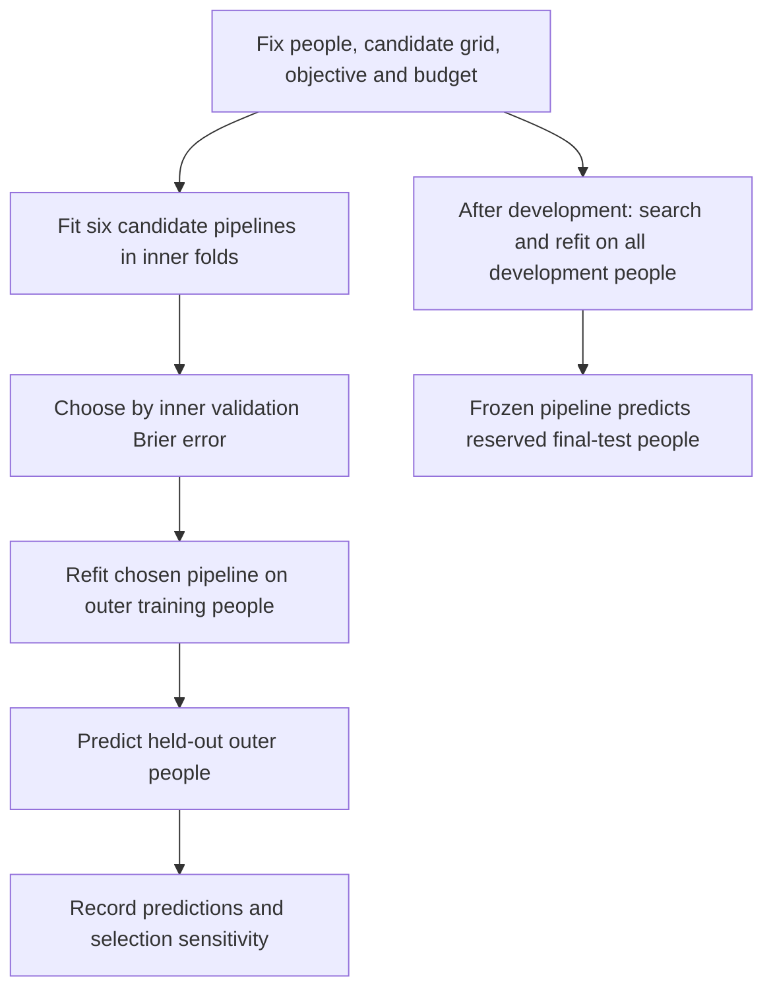

# Tune the breast cancer workflow, not the final test

[Breast cancer book, Chapter 11](../06_RESOURCES/Genomics/BREAST_CANCER_60_GENE_COMPANION.md#applying-machine-learning-to-breast-cancer-data) · [Study evidence](breast-cancer-evidence.md) · [Advanced training](advanced-breast-cancer-training.md) · [Visual data slices](visual-data-guide.md)

Model tuning chooses the settings of a training procedure. In our paired-specimen project, it chooses how many candidate assay measurements to retain and how strongly to regularize a logistic predictor of the recorded tissue category. The question remains **prediction for specimens from previously unseen people**. Tuning does not convert that task into future cancer risk, recurrence prediction, or a treatment-selection claim.

Source check: 2026-10-16. This guide connects the repository's executed settings to primary methodological evidence and the breast cancer application papers. Numerical search settings below describe synthetic teaching runners; they are not recommended clinical defaults or an optimized breast cancer panel.

## Separate the three kinds of decision

| Decision | Example in this project | Where it belongs |
| --- | --- | --- |
| Research design | Target, prediction time, eligible people, assay scale, person/site/time separation | State before performance-driven model development |
| Hyperparameter selection | Retain 5, 10 or 20 assay columns; choose logistic C | Inner training/validation within development |
| Fitted parameters | Imputation medians, selected columns, scales and logistic coefficients | Learn again from the training rows in each fit |

A researcher can revise a design, but must document that change and reassess the resulting procedure appropriately. Trying different random seeds until a score improves is also selection; it does not supply stronger independent evidence.

## Our concrete tuning contract

The [paired-specimen runner](examples/breast_cancer_feature_selection.py) has 60 invented people, each contributing one tumor-labeled and one comparator-labeled specimen, with 48 arbitrary assay measurements. Keep the 15 final-test people apart. Within the 45 development people, use three outer folds, with three inner folds inside each outer training partition.

**Selection objective:** minimize validation Brier error, the average squared difference between the predicted probability and binary target. The scikit-learn search uses `neg_brier_score`, so it **maximizes a negative score**. Our exported candidate traces convert this back to positive Brier error, where **smaller is better**. This choice addresses probability error; it does not establish probability calibration or usefulness for a clinical decision.

| Tuned setting | Current search values | What changing it means |
| --- | --- | --- |
| `select__k` | 5, 10, 20 | Number of assay columns retained by the training-only F-score screen |
| `model__C` | 0.1, 1.0 | Inverse regularization strength; larger C permits weaker penalization |
| Cross-product | Six candidates | Each candidate is fitted and scored on the same three inner divisions |

Within each fit: learn median imputation → rank and retain columns → learn scaling → fit the logistic model. A candidate cannot reuse a selector learned from the entire development cohort. The F-score is a screening heuristic, not paired gene-discovery inference. Identity keys, specimen labels and final-test outcomes stay outside the predictor columns.



**Text equivalent:** Inner scores choose settings. Outer predictions assess the tuned procedure on excluded people. The final development search produces the saved predictor; the reserved test assesses that final procedure. Any manual redesign prompted by outer results is part of development and must be reflected in the evaluation claim.

## Read every candidate, not just the winner

The runner now exports a candidate trace for each of the three outer searches and the final development search:

| `report.json` field | Interpretation |
| --- | --- |
| `outer[i].search_candidates` | Six configurations evaluated within that outer training slice |
| `final_search_candidates` | Six configurations evaluated within all development people |
| `parameters` | Subset size and C for that candidate |
| `fold_brier` | Three inner held-out Brier errors |
| `mean_brier` | Mean of those fold errors; these equal-size synthetic folds have equal row weights |
| `rank`, `chosen` | Search rank and the configuration selected for refitting |
| `outer_predictions`, `nested_development` | Predictions and metrics from people excluded from each entire inner search |
| `tuning_contract` | Metric direction, number of candidates, folds, searches and pipeline-fit budget |

The selected candidate's inner score benefited from being selected. Read the outer-held-out and final-test assessment for the corresponding evaluation question. Fold-to-fold spread is descriptive; treating overlapping folds as independent replicates and calling their standard error a confidence interval can understate uncertainty. See [BC-M04](breast-cancer-evidence.md#bc-m04), [BC-M05](breast-cancer-evidence.md#bc-m05), and [BC-M09](breast-cancer-evidence.md#bc-m09).

Exact-score ties use the search implementation's first-best candidate ordering; the runner does not implement a prespecified preference for smaller panels or a one-standard-error selection rule. A later simplicity rule would be part of the training procedure and would need its own evaluated implementation. Compare with a prespecified all-feature predictor before claiming that subset selection improves prediction; the current example supplies a prevalence baseline rather than that all-feature comparison.

## Count the fitting budget

Each search performs six candidates × three inner folds = **18 candidate pipeline fits**, then one refit. Three outer searches plus one final development search therefore perform **72 candidate fits + 4 refits = 76 pipeline fits**. This counts complete pipeline fits, not optimizer iterations or diagnostic predictions. Permutation diagnostics apply fitted pipelines without refitting them.

Six candidates × 3 × 4 does not mean 72 independent datasets. All of the fitting reuses subsets of the same 45 development people. Increasing the budget can overfit a noisy selection criterion without adding participants. The budget should earn its cost through an appropriately assessed comparison, rather than by producing a more attractive selected inner score.

Run the example and inspect its records:

```bash
python3 04_machine_learning/examples/breast_cancer_feature_selection.py /tmp/breast-cancer-tuning
python3 04_machine_learning/tests/test_breast_cancer_feature_selection.py
```

Use the [pinned Python dependencies](requirements-python.txt), run from the repository root, and choose a new output directory outside the repository with an existing parent. `report.json` and `feature_review.csv` connect tuning to retained assay columns and held-out diagnostics. Model and input files support prediction replay; versions and checksums identify the run artifacts.

## How the other project runners tune

| Runner | Executed search | Selection objective and boundary | What to avoid inferring |
| --- | --- | --- | --- |
| [Caret](examples/caret_case.R) | Elastic net: alpha 0, 0.5, 1 crossed with lambda 0.01, 0.1; forest: mtry 2, 3 crossed with minimum node size 5, 10; fixed 100 trees | Four stratified development folds maximize ROC AUC; separate final holdout | This is not nested outer evaluation, paired-specimen admission, or a test of the book's genes. Grid rows need not equal separate solver calls because engines may reuse submodels |
| [General Python classification](examples/sklearn_methods.py) | Logistic C 0.1/1; forest leaf size 3/8 with 50 trees; boosting max leaf nodes 3/7 with 50 iterations and early stopping disabled | Nested three-by-three family-grouped search maximizes negative Brier score | The runner does not select the best model family from final-test results |
| [General Python regression](examples/sklearn_methods.py) | Ridge alpha 0.1/1/10; forest leaf size 3/8 with 50 trees | Nested family-grouped search maximizes negative mean squared error; exports RMSE, MAE and R-squared | Numerical prediction and tissue-category classification have different targets and losses |
| [Paired-specimen selection](examples/breast_cancer_feature_selection.py) | Six k/C candidates, with complete candidate traces | Nested person-grouped search; final test kept out of selection | This is synthetic tissue-category evidence about software behavior, not a patient-level cancer endpoint |

The caret objective emphasizes ranking; the Python classification objective emphasizes probability error. Keep that difference visible when comparing outputs. Changing the objective, feature set, or model family after inspecting a test score consumes that assessment for development. A fresh run with a different seed does not restore an untouched test.

## A strong search-method corpus, applied to this project

| Evidence | Methodological lesson | Project-specific use and status |
| --- | --- | --- |
| [Varma and Simon, 2006](breast-cancer-evidence.md#bc-m04) | Tuning and evaluation need separate resampling boundaries | Nested patient-grouped selection executes; the caret runner retains a separate holdout |
| [Cawley and Talbot, 2010](breast-cancer-evidence.md#bc-m05) | Model selection itself can overfit a finite-sample performance criterion | Keep the six-candidate scope explicit; count later human choices and model-family searches |
| [Bergstra and Bengio, 2012](breast-cancer-evidence.md#bc-m06) | Random search is a useful budgeted baseline in broader spaces | A future assay model with many settings could compare fixed-budget random search; the current six-candidate grid remains easier to inspect |
| [Snoek et al., 2012](breast-cancer-evidence.md#bc-m07) | Bayesian optimization can use earlier trials to choose later configurations | Reference extension for expensive pathology/fusion training; retain patient folds, objective and complete trial history |
| [Li et al., 2018](breast-cancer-evidence.md#bc-m08) | Multi-fidelity search allocates resources and stops weak trials | Reference extension; define resource and stopping rules inside training, preserving group/class structure |
| [Bengio and Grandvalet, 2004](breast-cancer-evidence.md#bc-m09) | Overlapping CV errors complicate uncertainty estimation | Do not turn three fold scores or selection frequencies into independent-sample confidence intervals |
| [Bischl et al., 2023](breast-cancer-evidence.md#bc-m10) | Search-space design, budgets and evaluation are parts of HPO practice | Record all of these in a study-specific tuning plan before expanding this project |

These are general methodological sources, not breast cancer clinical trials. The [Sammut/NAT-ML source review](breast-cancer-evidence.md#what-the-author-code-shows-and-what-we-would-adapt) provides the direct breast cancer implementation bridge: pipeline-based feature filtering and randomized search, with explicit limits on the source we inspected. Our six-candidate runner is independently written and does not reproduce NAT-ML's tuning results.

Random search, Bayesian optimization and Hyperband are not currently deployed in this repository. A model's learning-rate or early-stopping settings would need a separate development stopping partition consistent with person/site grouping. Reducing a resource by selecting arbitrary specimens can change class balance and split paired people. More sophisticated search does not repair that design error.

## Recent tuning evidence: what to read next

The [2021–2025 tuning corpus](recent-tuning-evidence.md) adds nine primary papers on reproducible benchmarks, DEHB, YAHPO Gym, SMAC3, PriorBand, strong defaults, TabRepo, overtuning and TabArena. Together with the 2023 review above, these supply ten recent sources, reviewed through 2026-10-16. Each card distinguishes reported findings, review extent, artifact status and a specific application to our paired-specimen task.

Start with overtuning before increasing the six-candidate grid; read strong defaults before claiming a benefit over a fixed model; use the budget and benchmark papers when designing an expensive pathology or multi-omic extension. These are reference mechanisms rather than additional executed deployments.

The [selection and validation corpus](recent-selection-validation.md) adds nine 2021–2026 publications, connecting tuning to gene-panel stability, validation-cohort precision, leakage audits and survival objectives. Read these before interpreting a selected configuration as a useful assay or prognosis model.

## Before extending the real study

Write a tuning plan stating the target and intended population, feature availability, group/time/site split, primary objective, candidate ranges and their rationale, search budget, seeds, worker limits, failure policy, refit rule, and the evidence that will decide whether the extension helped. Add calibration and clinical utility only under their own fitting and assessment rules; do not label a Brier-optimized tissue classifier a treatment decision tool.

Keep failed trials and warnings visible. The Python examples raise fitting errors rather than silently replacing them with a favorable score. Preserve the candidate trace, selected feature contract, outer predictions, final-test protocol, software versions and replay checks. Patient-level uncertainty and external-site validation remain explicit work before transportability claims.

Official implementation documentation: [scikit-learn parameter search](https://scikit-learn.org/stable/modules/grid_search.html), [nested assessment](https://scikit-learn.org/stable/auto_examples/model_selection/plot_nested_cross_validation_iris.html), and [caret training/tuning](https://topepo.github.io/caret/model-training-and-tuning.html). Upstream documentation is distinct from the pinned runtime actually tested here.

[Return to the breast cancer application](../06_RESOURCES/Genomics/BREAST_CANCER_60_GENE_COMPANION.md#applying-machine-learning-to-breast-cancer-data)
