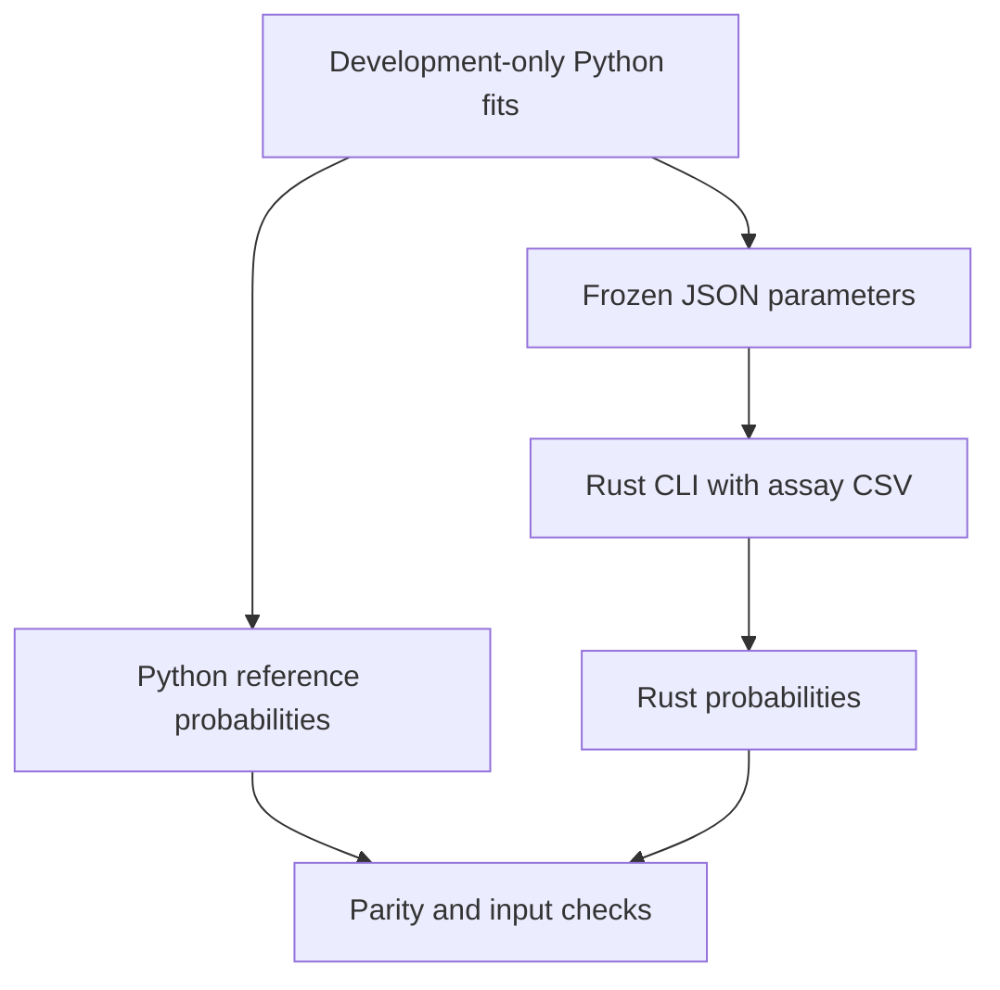

# Deploy the assay models in Rust

[Machine learning](README.md) · [Comparison case](model-comparison.md) · [Rust source](rust/src/lib.rs) · [Breast cancer book, Chapter 11](../06_RESOURCES/Genomics/BREAST_CANCER_60_GENE_COMPANION.md#applying-machine-learning-to-breast-cancer-data)

Rust can run machine-learning predictions and train models through suitable libraries. This first deployment carries the book's existing assay question into a compiled **Rust prediction CLI**. Python retains the person-grouped training, tuning and assessment. Rust applies the frozen imputation, selected-column order, scaling and logistic coefficients from each final development fit. It produces probabilities for the recorded synthetic specimen category.

The two procedures remain **selected features plus tuned C** and **all features with C fixed at 1**. No new optimizer, assessment cohort, winning procedure or biological interpretation is introduced by changing the prediction runtime. The 48 arbitrary features remain distinct from the book's 60-gene catalog.

## What is deployed

| Component | Responsibility | Status |
| --- | --- | --- |
| [Python comparison runner](examples/breast_cancer_comparison.py) | Train both procedures on development people; assess excluded people | Existing executable workflow |
| [Portable exporter](examples/export_rust_inference.py) | Extract fitted numeric parameters and produce label-free assay CSVs and reference probabilities | Executable |
| [Rust crate](rust/Cargo.toml) | Validate the input/schema, apply frozen transforms and compute class-1 probabilities | Executable; CPU, f64 |
| [Cross-language validator](validation/validate_rust_inference.py) | Compare both runtimes and challenge malformed inputs and output destinations | Executable |
| [Committed example](rust/example/README.txt) | Two model JSON files, 125 invented input rows, Python references and provenance | Rebuildable teaching snapshot |
| Native Rust fitting, GPU inference, HTTP service | Separate modeling or delivery extensions | Reference options below; not implemented here |



Deployment replay checks the computation. The original grouped outer assessment continues to answer how the training procedure performed on excluded people. The final fitted model's predictions on development specimens are in-sample replay values and must not replace the gallery's outer-held-out development probabilities.

## Build and run the saved example

Install Rust through [the official toolchain installer](https://www.rust-lang.org/tools/install). The checked toolchain is **Rust 1.90.0**. From the repository root:

```bash
rustup toolchain install 1.90.0 --profile minimal --component rustfmt,clippy
CARGO_TARGET_DIR=/tmp/pauls-notes-rust-build cargo +1.90.0 build --release --locked --manifest-path 04_machine_learning/rust/Cargo.toml
/tmp/pauls-notes-rust-build/release/assay-predict 04_machine_learning/rust/example/selected.json 04_machine_learning/rust/example/specimens.csv /tmp/assay-rust-selected
/tmp/pauls-notes-rust-build/release/assay-predict 04_machine_learning/rust/example/all_features.json 04_machine_learning/rust/example/specimens.csv /tmp/assay-rust-all-features
```

Choose new output directories outside the source repository, with existing parents. The command line is `assay-predict MODEL.json SPECIMENS.csv NEW_OUTPUT_DIRECTORY`. Paths can be quoted when they contain spaces. After compilation, the prediction binary runs without a Python or R runtime; rebuild for the target operating system/architecture and retain its runtime libraries. The commands above use a Unix-style executable path.

Each run writes:

| File | Meaning |
| --- | --- |
| `predictions.csv` | Specimen identity and `probability_class_1`, in input order |
| `run.json` | Model/task identity, feature and specimen counts, binary package/compiler versions, build target, platform, and SHA-256 identities of the model, input and predictions |

Input/model validation happens before creating an output directory. Existing directories, files and symlinks are rejected. Output files use exclusive creation. An I/O failure during writing may leave an incomplete new directory; retain the error and choose a new destination after investigating. Treat a successful exit and a readable, checksum-consistent `run.json` as the completion record.

## What happens to a measurement

The version 1 JSON stores the ordered feature names, training medians, increasing selected-column indices, selected-column means/scales, coefficients, intercept, positive-class identity, task/protocol and training partition. Rust rejects unknown fields and incompatible schemas, dimensions, duplicate indices, nonfinite parameters and nonpositive scales.

For selected column j, replace a missing measurement with its **saved development median**, then subtract the saved mean and divide by its saved scale. Multiply by its coefficient and add the intercept across the panel. Convert that logit to a probability with a numerically stable logistic function. No statistics are estimated from the prediction batch. The fixed all-feature procedure follows the same calculation with every column retained.

The input header is exactly `specimen_id,Feature001,...,Feature048` for this snapshot, in that order. Standard CSV quoting is supported. Blank numeric cells and uppercase `NA` denote missing values. Other numeric fields must parse to finite f64 values. The input contains no target, person identifier or partition column; identifiers are preserved for joining predictions, never used as predictors. Duplicate/blank/padded/multiline specimen IDs, reordered or extra columns, ragged rows, infinity, NaN and arithmetic overflow fail explicitly. One specimen can be scored independently; paired-person completeness is a training/assessment requirement rather than an inference requirement.

The CLI returns probability of the recorded category **1**, with no diagnostic threshold or cancer-risk claim. Applying it to arbitrary gene counts, different measurement units or a real patient would violate this teaching deployment's data meaning even if the numeric schema happened to match.

## Export a fresh, trusted training run

With the [pinned Python dependencies](requirements-python.txt), create the comparison bundle, then export it:

```bash
python3 04_machine_learning/examples/breast_cancer_comparison.py /tmp/assay-python-training
python3 04_machine_learning/examples/export_rust_inference.py /tmp/assay-python-training /tmp/assay-portable --trusted-local-bundle
```

`--trusted-local-bundle` identifies an artifact created locally from trusted repository code. The exporter checks the original inventory, required artifacts, modeling versions, grouped partition coordinates, supported pipeline operations and reserved-test replay before writing JSON. **Checksums detect changed bytes; they do not establish that a pickle is safe.** Never use this flag for an untrusted downloaded `joblib` file. Rust consumes numeric JSON and CSV; it never loads that Python model object.

The export contains both model JSON files, `specimens.csv`, `reference-probabilities.csv`, `export.json`, an explanation and `sha256.json`. Provenance retains the source model/input/report hashes, training code hashes, exporter/Rust source hashes and runtime versions. The fixture includes 120 specimens and five numerical probes: all missing, all zero, large positive, large negative and alternating large values. Probes challenge arithmetic and supply no additional people or validation observations.

## Check equivalence and failure handling

```bash
CARGO_TARGET_DIR=/tmp/pauls-notes-rust-build cargo +1.90.0 fmt --manifest-path 04_machine_learning/rust/Cargo.toml -- --check
CARGO_TARGET_DIR=/tmp/pauls-notes-rust-build cargo +1.90.0 clippy --locked --manifest-path 04_machine_learning/rust/Cargo.toml --all-targets -- -D warnings
CARGO_TARGET_DIR=/tmp/pauls-notes-rust-build cargo +1.90.0 test --locked --manifest-path 04_machine_learning/rust/Cargo.toml
python3 04_machine_learning/tests/test_rust_export.py
python3 04_machine_learning/validation/validate_rust_inference.py 04_machine_learning/rust/example /tmp/assay-rust-validation --binary /tmp/pauls-notes-rust-build/release/assay-predict
```

Six Rust tests independently check a known imputed/standardized logit, class direction, stable extreme probabilities, overflow, model schemas and CSV failures. Four Python exporter tests check actual learned parameters, unsupported transforms, trust/integrity boundaries and a fresh end-to-end export. The validator runs the actual release binary for both procedures, matches identities and all 125 probabilities to Python within **absolute tolerance 1e-12**, verifies run hashes and rejects eight malformed-input/output cases. It preserves existing results when rejecting an overwrite and creates no output for malformed inputs.

The [recorded Rust validation](evidence/rust-validation-2026-10-16.json) records observed differences and artifact identities. [CI](../.github/workflows/machine-learning-validation.yml) compiles, formats, lints and tests Rust, then checks both the committed portable example and a fresh Python training/export. The ordinary Python validation command includes the four exporter tests; its [recorded run](evidence/rust-python-validation-2026-10-16.json) passes **29 tests across six suites** and all three Python deployments. The earlier 25-test gallery report remains historical.

Matching probabilities demonstrates implementation equivalence within this contract. It supplies no new accuracy, speed, stability, calibration, clinical utility or external-site evidence. Benchmark speed only with a declared workload, build profile, platform and comparison runtime; no speedup is claimed here.

## Native Rust packages and next extensions

Reviewed on 2026-10-16 against upstream documentation. These package routes are **references**, with no training or inference benchmark in this repository yet.

| Rust route | Appropriate extension to investigate | Required project work |
| --- | --- | --- |
| [Linfa / linfa-logistic 0.8.1](https://docs.rs/linfa-logistic/0.8.1/linfa_logistic/) | Native Rust classical-model fitting; binary/multinomial logistic models | Carry over person-grouped folds, training-only transforms, declared penalty/objective, tuning budget and saved prediction replay |
| [SmartCore 0.6.15](https://docs.rs/smartcore/0.6.15/smartcore/) | Native classical models including trees, forests and linear methods | Verify the chosen learner's probability interface, grouping, preprocessing and serialization for the pinned release |
| [Burn](https://burn.dev/) | Rust neural-network training and deployment | Declare an architecture, CPU/GPU backend, loss, stopping rule and grouped assessment before expanding the assay task |
| [Candle](https://github.com/huggingface/candle) | Rust tensor/model execution with CPU and supported accelerators | Check model operations, precision, backend, weight terms and actual deployment behavior |
| [ort](https://docs.rs/ort/latest/ort/) | Execute compatible exported graphs through ONNX Runtime's Rust binding | Validate conversion of the complete preprocessing graph, operator/runtime support, class mapping and per-row parity |

A sensible next native-training experiment would fit a declared Linfa logistic baseline on the same grouped development partitions. Its regularization objective and defaults require their own contract; a parameter with a similar name does not ensure the same optimization problem. Keep any training-method comparison separate from this frozen-runtime replay, and assess it on people excluded from its own selection.

Implementation references: [StandardScaler's saved mean/scale](https://scikit-learn.org/1.8/modules/generated/sklearn.preprocessing.StandardScaler.html), [binary logistic coefficients/classes](https://scikit-learn.org/1.8/modules/generated/sklearn.linear_model.LogisticRegression.html), and [Cargo manifests and lockfiles](https://doc.rust-lang.org/cargo/guide/cargo-toml-vs-cargo-lock.html). The [locked dependency graph](rust/Cargo.lock) and toolchain file make the executed dependency choices explicit.
