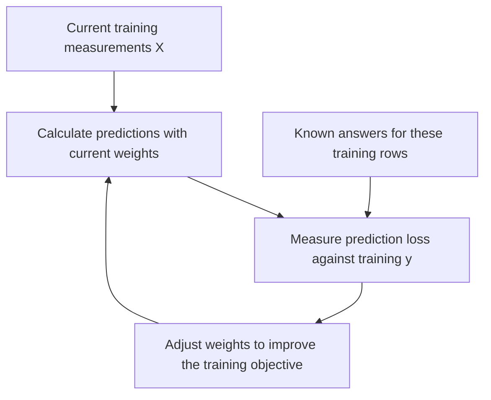
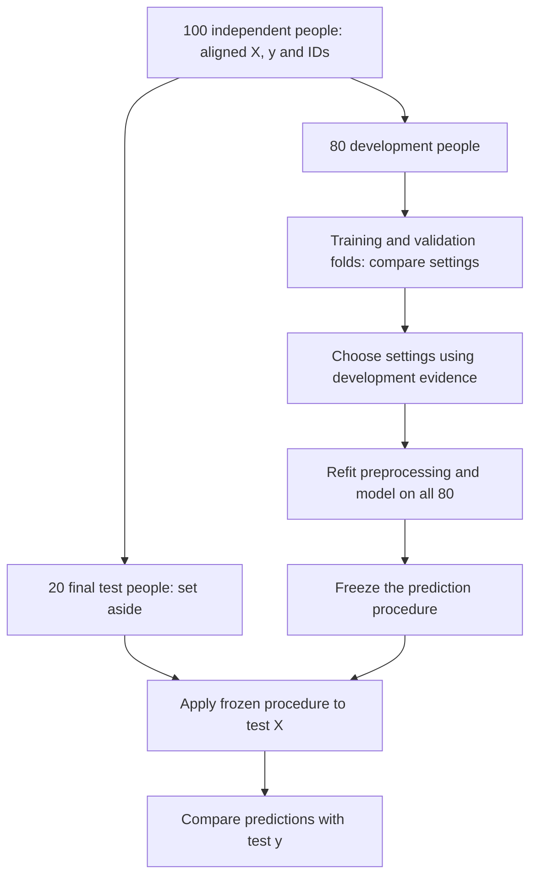
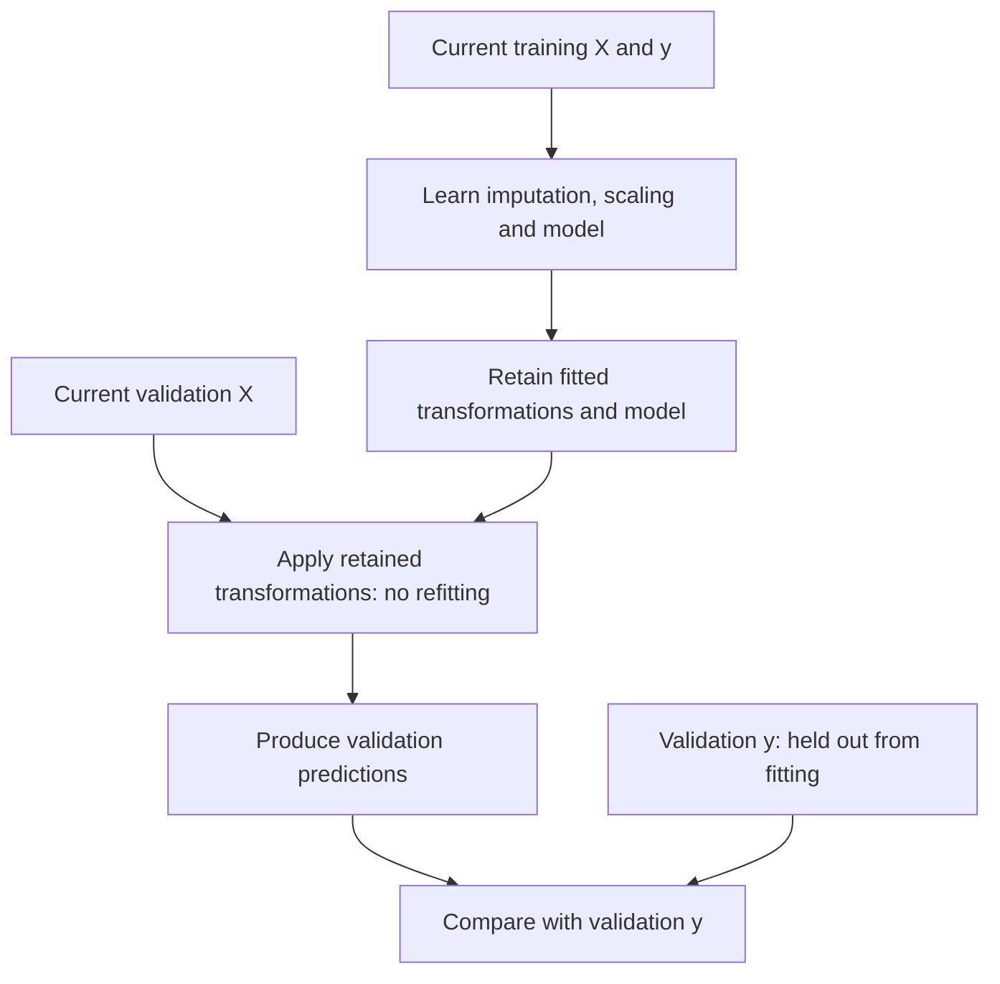
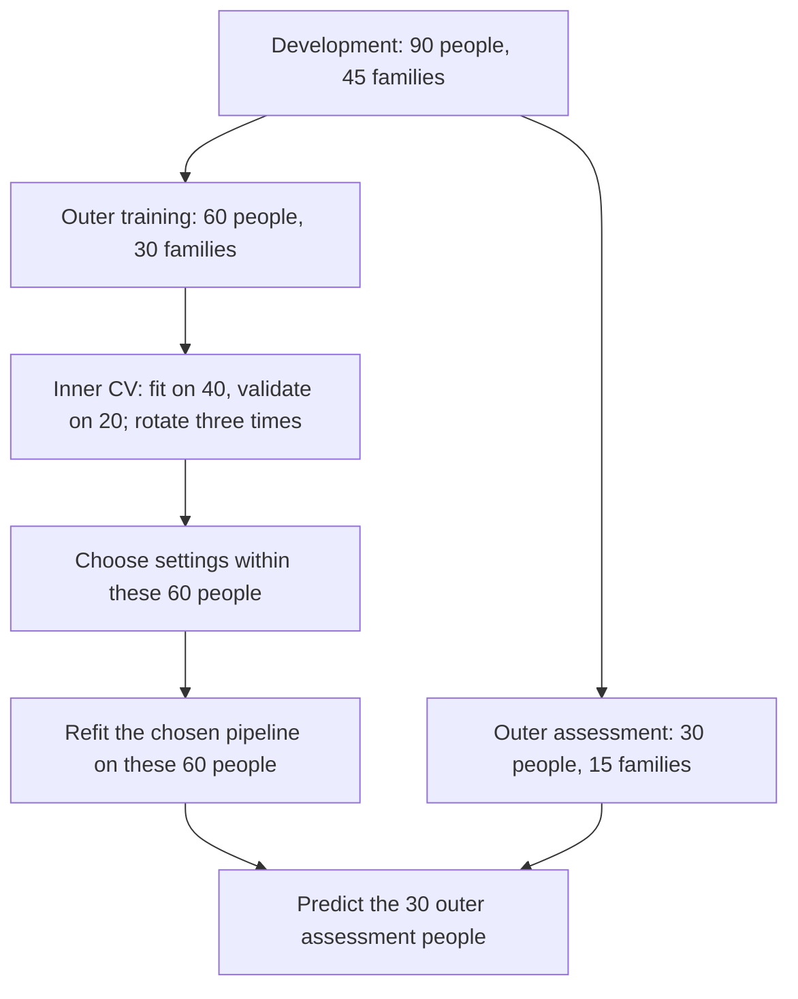

# See how data becomes a trained model

[Machine learning subjects](README.md) · [What is machine learning?](what-is-machine-learning.md) · [Basic algorithms](basic-algorithms.md) · [Breast cancer application](../06_RESOURCES/Genomics/BREAST_CANCER_60_GENE_COMPANION.md#applying-machine-learning-to-breast-cancer-data)

We give a learning procedure examples, let it fit a relationship, and ask it to predict observations it did not fit. **Slicing the data determines what counts as unseen.** This guide follows the rows, measurements, and outcomes through that process.

The small tables and 100-person split below are invented teaching examples. The final sections map them to the repository's executable synthetic workflows. No figure here reports breast cancer findings.

## 1. Identify the inputs, the answer, and the owner of each row

Imagine a table with one specimen per person. The question is whether measurements can predict a recorded specimen category. The measurements have arbitrary demonstration units.

| Person ID | Marker A | Marker B | Recorded category |
| --- | ---: | ---: | --- |
| P01 | 2 | 7 | Comparator |
| P02 | 4 | 3 | Tumor |
| P03 | Missing | 5 | Comparator |
| P04 | 6 | 8 | Tumor |

We separate three roles before fitting:

| Object | What it contains | What we do with it |
| --- | --- | --- |
| **X: features** | Marker A and Marker B, in a fixed order | Supply measurements available at the intended prediction time |
| **y: target** | Recorded category for each row | Compare predictions with the known answer; training also uses it to fit the relationship |
| **Identity and grouping keys** | Person ID, and family or specimen links when needed | Align records and define splits; exclude identifiers from these examples' predictors |

The model predicts a recorded tissue category. That question alone does not establish a screening test, treatment recommendation, or future recurrence forecast.

For expression data, the incoming matrix may have **genes in rows and specimens in columns**. Match specimen IDs to metadata, select the intended measurements, and transpose into observations-by-features when the modeling interface requires it. After transposition, verify that row *i* in X, y, and the identity table still refers to the same observation. A transpose changes orientation; it does not create additional independent people.

### What does training actually change?

For logistic regression, a simplified score is `b + wA × Marker A + wB × Marker B`. A logistic transformation converts that score into a probability between zero and one. The fitted quantities `b`, `wA`, and `wB` are the intercept and feature weights. The features and recorded answers stay fixed during a fit; the optimizer adjusts these quantities to improve its objective.

**Read the diagram:** This is a conceptual iterative optimization loop, not a claim that every algorithm uses identical updates. The loss measures disagreement with the known answers; a penalty can also discourage overly complex weights. A stopping rule ends fitting. Validation scores choose settings around this process; validation answers do not directly update the fitted weights in that training run.

A tree learns branching rules instead of these regression weights. A forest fits many trees and combines their predictions. Different algorithms change different fitted objects, while the boundary between training and assessment remains essential. The [algorithm guide](basic-algorithms.md) explains these choices.

## 2. Reserve the final test before learning from measurements

Here is an illustrative design with 100 independent people: 80 go into development and 20 into a protected final test. These proportions explain the idea; they are not a rule for choosing study size.

**Read the diagram:** Development data support model building. Final test measurements enter only after the procedure is fixed. Their answers are used for final scoring, rather than fitting or choosing settings. Repeatedly looking at the test score and changing the model turns that test into part of development.

We split **observations by identity**, not measurement columns into competing sets. Each partition retains the same feature definitions. For an independent-person classification design, stratification can help retain both outcome classes in each partition. Grouping or time restrictions may also be necessary; stratification does not supply those protections.

## 3. Rotate the validation slice within development

Inside those 80 development people, make four blocks of 20. For each candidate setting, fit four separate copies of the procedure. In each fit, one block is held out for validation.

| Fit | Block A: 20 people | Block B: 20 people | Block C: 20 people | Block D: 20 people | Final test: 20 people |
| --- | --- | --- | --- | --- | --- |
| 1 | **Validate** | Train | Train | Train | Set aside |
| 2 | Train | **Validate** | Train | Train | Set aside |
| 3 | Train | Train | **Validate** | Train | Set aside |
| 4 | Train | Train | Train | **Validate** | Set aside |

**Each fit learns from 60 people and predicts 20 held-out development people.** Across these fits, every development person receives one validation prediction for that candidate. The four training sets overlap; they are not four independent studies. The final test people never rotate into training.

A *fold* is one of these resampling divisions. Code may call the training rows **analysis** and the held-out rows **assessment**. “Validation” can mean different things elsewhere, so always identify exactly which rows it refers to.

A candidate setting might specify a regression penalty or a tree's minimum leaf size. Evaluate the candidates with a metric chosen for the research question. Choose settings from the development scores, then fit a fresh procedure on all 80 development people. This final refit learns new coefficients or trees; it is not an average of the four training datasets.

## 4. Learn preprocessing inside each training slice

Replacing missing values, estimating a scaling transformation, selecting features, and fitting PCA all involve learning from data. In a predictive workflow, place those learned operations inside the resampling boundary.

**Read the diagram:** Training creates the transformation rules and fitted model. Validation uses those rules unchanged. A new fold starts again with its own training rows; it does not reuse preprocessing learned from the previous fold or the full cohort.

For a small imputation example, suppose the current training values for one marker are **2, 4, and 6**. Their median is **4**. Replace a missing validation value with **4**, even if the other observed validation values are very large. Recomputing the median using validation values would let that held-out slice influence the procedure being assessed.

| Operation | During a training fit | On validation, final test, or a new observation |
| --- | --- | --- |
| Missing-value imputation | Learn replacement values from training X | Apply those replacement values |
| Scaling | Learn centers and scales from training X | Apply the retained centers and scales |
| Predictive feature selection | Select using only the current training partition | Keep the selected feature definitions and order |
| PCA within a prediction pipeline | Learn component directions from training X | Project with those directions |
| Model fitting | Learn parameters from training X and y | Predict using fitted parameters |
| Scoring | Training scores can describe fit | Compare held-out predictions with held-out y |

Fixed unit conversion and schema checks differ from estimating transformations. A prespecified conversion from one unit to another does not need a cohort-wide mean. Document any upstream assay processing that already learned from pooled samples; wrapping later steps in a pipeline cannot undo earlier leakage.

## 5. Keep related records together

One person may contribute several visits, specimens, image patches, or cells. If the intended assessment concerns new people, assigning their related rows to both training and assessment can make the task easier than predicting a new person.

| Record | Person | Related family | Example partition |
| --- | --- | --- | --- |
| Specimen A1 | P01 | F01 | Development |
| Specimen A2 | P01 | F01 | Development |
| Specimen B1 | P02 | F01 | Development |
| Specimen C1 | P03 | F02 | Final test |
| Specimen C2 | P03 | F02 | Final test |

This allocation keeps each person and family together. Apply the same grouping rule inside cross-validation, rather than only in the initial split. If family dependence is relevant, keeping each person together alone does not keep relatives apart.

Choose the split to match the intended use:

| Intended prediction | Assessment design to consider |
| --- | --- |
| Previously unseen people | Separate people across partitions |
| Previously unseen families | Separate families across partitions |
| A different hospital | Hold out sites, with sufficient independent sites for the intended comparison |
| A later time period | Train on earlier information and assess later observations; account for repeated people and label timing |

A seed makes a randomized split repeatable. It does not make an inappropriate split scientifically valid. Having many cells or image patches also does not mean having that many independent participants.

## 6. See what an extra, outer loop does

Choosing the best setting uses validation scores. **Nested cross-validation adds an outer held-out slice to assess the procedure that makes that choice.** The inner loop tunes settings; the outer slice evaluates the resulting tuned fit.

The Python example has 120 synthetic people in 60 two-person families. Its initial group split assigns **90 people in 45 families to development** and **30 people in 15 families to the final test**. Within development, three outer folds and three inner folds give this view of one outer iteration:

**Read the diagram:** Those 30 outer assessment people contribute neither to the inner search nor its preprocessing fits. Rotate the outer assessment families three times to obtain outer-held-out predictions for all 90 development people. The numerical counts work here because every synthetic family contains exactly two people. With unequal group sizes, equal numbers of groups need not produce equal numbers of rows.

After outer evaluation, the example performs another inner search on all 90 development people and refits each model family there. That fitted pipeline predicts the 30 final test people. Outer scores assess the tuning procedure; they are not the weights used for this final fit. The example exports results for several model families, so do not use their final test scores to select a winning family and then present that same score as an independent assessment of the selection.

## 7. Follow the actual code and saved split records

| Workflow | What is split | What happens during development | Where to inspect |
| --- | --- | --- | --- |
| [R caret example](examples/caret_case.R) | 160 synthetic independent people; approximately three quarters of each class go to development, with per-class rounding | Four stratified CV folds compare elastic-net and random-forest settings; imputation, centering, and scaling are learned within resampling; selected fits are refitted on development | `synthetic_cohort.csv` contains identities and outcomes; `split_plan.rds` contains cohort row assignments and development-local fold positions |
| [Python methods example](examples/sklearn_methods.py) | 120 synthetic people grouped into 60 families; 90 development people and 30 final test people | Three outer and three inner group folds assess classification and regression procedures; a final search refits each model family on development | `splits.json` maps full-cohort positions to people and families; `metrics.json` records inner and outer membership in development-local coordinates |

In the Python records, a development-local position must first be mapped through the development index to find its full-cohort row. In R, the fold positions likewise index the development subset. Confusing these coordinate systems can silently assign the wrong identities to a fold. Python positions start at zero; R positions start at one.

The [caret walkthrough](caret-deployment.md) and [independent deployment guide](methods-and-deployments.md) provide installation, execution, and output instructions. The split checks deliberately challenge overlap and leakage. Inspect membership before interpreting a performance score.

## 8. What do we finally keep, and what does a score tell us?

A trained prediction procedure includes **the feature definitions and order, fitted preprocessing, and fitted model**. Keep its training provenance, split records, software versions, and assessment results alongside it. For a new observation, validate the schema, apply the retained transformations, and predict. Its outcome is unknown at prediction time.

For a classifier, a probability is different from a category decision: converting a probability to a category requires a threshold. Decide how thresholds and any calibration step will be fitted and evaluated within development. Ranking, probability accuracy, and clinical usefulness answer different questions. For numerical predictions, report errors in the outcome's units alongside a baseline. A strong training score alone does not show generalization.

PCA and clustering do not use a supervised target. In the Python demonstration, their transformations are fitted on development and applied to held-out measurements. This illustrates transfer of a fitted representation; a cluster or a silhouette score is not an independently verified disease category. A descriptive analysis of an entire dataset has a different aim and should be labeled accordingly.

## Check your understanding

Before reading a score, trace one person's records and answer:

1. Which partition contains this person, and where are their related records?
2. Could their measurements influence an imputer, scaler, feature selection, or fitted model used to predict them?
3. Which scores chose the settings, and which observations remained outside that choice?
4. When the final procedure predicts a new person, which saved objects does it use?

**Worked answers:** In the illustrative four-fold design, a development person is held out for validation once per candidate and trains other fold fits. Their validation prediction must use preprocessing learned without their block. Development validation scores choose settings; the final test remains outside that choice. The final refit uses all development people, and prediction uses its retained feature contract, preprocessing, and model. Related records follow the grouping rule at every boundary.

## Primary documentation and implementation scope

The diagrams explain the repository's source code and invented teaching tables; they are not reproduced research figures. The current Python environment is pinned separately in [requirements-python.txt](requirements-python.txt). These upstream guides support the general methods, without implying that the repository tests the newest upstream release:

- [scikit-learn: cross-validation and grouped observations](https://scikit-learn.org/stable/modules/cross_validation.html).
- [scikit-learn: preprocessing and data leakage](https://scikit-learn.org/stable/common_pitfalls.html).
- [scikit-learn: nested versus non-nested cross-validation](https://scikit-learn.org/stable/auto_examples/model_selection/plot_nested_cross_validation_iris.html).

[Return to machine learning subjects](README.md)
