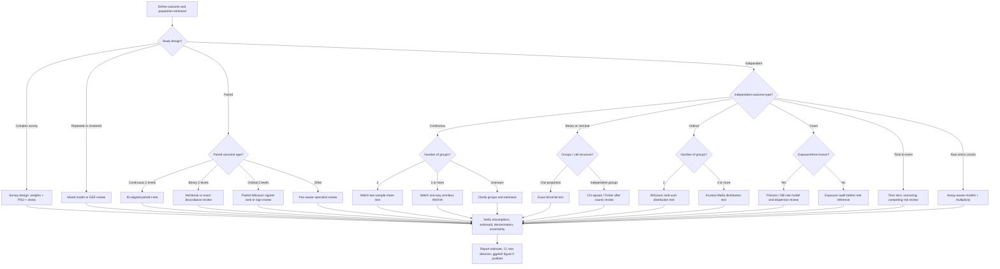

# Biomedical Statistical Testing — Design-first Decision Tree

**Paul's Notes | Expanded method selector and literature crosswalk | 2026-11-08**

[Test selection guide](../03_learning/biomedical-statistics-decision-guide.md) · [Selector R source](R/biomedical_test_selector.R) · [R library index](R/README.md) · [Literature matrix](Literature/BIOSTATISTICS_R_LITERATURE_2021_2026.md) · [Method intake rules](STATISTICAL_METHOD_INTAKE.md)

## Purpose and scope

Choose a defensible *starting method*, not automatically an analysis. A test is eligible only after checking the independent sampling unit, estimand, research question, variable scale, pairing, design weights, clustering, exposure and censoring. The source module never reads a dataset or runs a hypothesis test.

## Decision flow — method families



**Priority rules:** Complex-survey/clustered/repeated sampling supersedes simple two-sample testing. Time-to-event and raw RNA-seq counts require specialized designs. If adjustment is requested, the helper returns regression-model review rather than a bare t-test. Multiple outcomes require a prespecified error-rate/multiplicity plan. Descriptive summaries are not hypothesis tests.

## Mapping from branch to R implementation

| Outcome and sampling design | Method ID | Availability | R implementation / first entrypoint | Critical safeguard |
| --- | --- | --- | --- | --- |
| Continuous, 2 independent groups | welch-t | Implemented on draft PR #39 | welch_mean_comparison() | Explicit reference and comparison, independent units, Welch CI |
| Continuous, paired visits | paired-t | Implemented on draft PR #39 | paired_mean_change() | ID + visit alignment, only complete pairs and after-before contrast |
| Continuous, 3+ independent groups | welch-anova | Implemented on draft PR #39 | welch_oneway_comparison() | Omnibus only, no automatic pairwise follow-ups |
| Ordinal/continuous, independent two-group rank question | wilcox-independent | Existing | wilcox_independent() | Compares distributions; not automatically medians or means |
| Ordinal/continuous paired rank question | signed-rank | Existing | wilcox_paired() | Paired keys and difference distribution |
| Matched binary | mcnemar | Documented | stats::mcnemar.test() | Construct matched 2-by-2 and review sparse discordance |
| Nominal independent categories | contingency-analysis | Documented | stats::chisq.test() or stats::fisher.test() | Counts, denominators and asymptotic/exact eligibility |
| 1 proportion | binomial-proportion | Documented | stats::binom.test() | Fixed eligible trials and true binary events |
| 3+ independent ordinal groups | kruskal-wallis | Documented | stats::kruskal.test() | Distributional estimand and ties |
| Repeated or clustered observations | correlated-outcome-review | Specialist review | lme4::lmer() / geepack::geeglm() | Cluster IDs, visit structure, covariance, diagnostics |
| Complex probability sample | survey-design-review | Specialist review | survey::svydesign() / survey::svyglm() | Design weights + PSU/strata/replicates, survey degrees of freedom |
| Count with exposure/time | count-rate-model-review | Specialist review | stats::glm() with offset, or NB review | Count/exposure/dispersion and excess-zero assumptions |
| Time to event with censoring | survival-analysis-review | Specialist review | survival::survfit() / survival::coxph() | Time zero, event coding, censoring, competing risks |
| Molecular raw counts | omics-design-review | Specialist review | DESeq2::DESeq(), edgeR::glmQLFit() | Library size, replicates, batch, FDR family |
| Prediction | prediction-validation-review | Specialist review | Study-specific predictive pipeline | Split unit, leakage, calibration and held-out evaluation |

## Running the adviser without passing a dataset

```r
source("06_RESOURCES/R/biomedical_test_selector.R")
case <- biomedical_method_decision(
  outcome_type = "continuous",
  design = "independent",
  question = "compare",
  n_groups = 2L,
  adjusted = FALSE,
  multiple_outcomes = FALSE
)
print(case)
case$method_id
case$required_checks
case$evidence_ids
```

Expected method: welch-t, if and only if the analyst separately establishes independent groups, a mean-difference estimand and an appropriate sampling design. The adviser returns method rationale and requirements, **not a p-value**.

## Complete reporting and reproducibility gate

1. Confirm lawful access to the dataset; establish sample eligibility, meaningful independent unit, schema, missingness and inclusion criteria.
2. Declare estimand, reference direction, hypothesis, alpha, multiplicity and analytic design before inspecting test results.
3. Use appropriate distribution/diagnostic checks, review influential values and missingness. Do not choose tests solely from a Shapiro-Wilk p-value.
4. Record N, n per group, excluded n, denominators, point estimate or effect measure, confidence interval, full-precision p-value, degrees of freedom where applicable, and prespecified decision rule.
5. Generate figures in **ggplot2 from the same computed result object** used for tables. Do not use Matplotlib preview images to claim reproducibility of R figures.
6. Verify package versions, run synthetic fixture tests, inspect rendered graphics, and keep scientific/design validation separate from successful code execution.

**Literature registry:** BS-001 through BS-019 are curated rather than exhaustive. Methods literature establishes rationale; current R documentation controls function signatures. The research-method registry in docs/research-method-map.json supplies stable route IDs.
